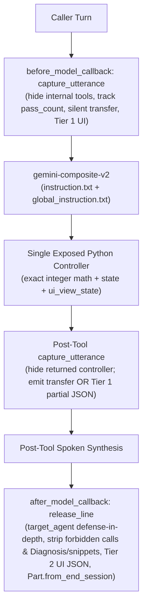
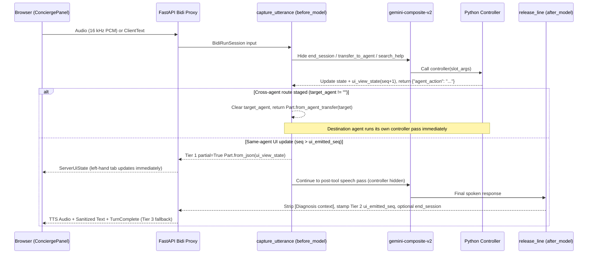
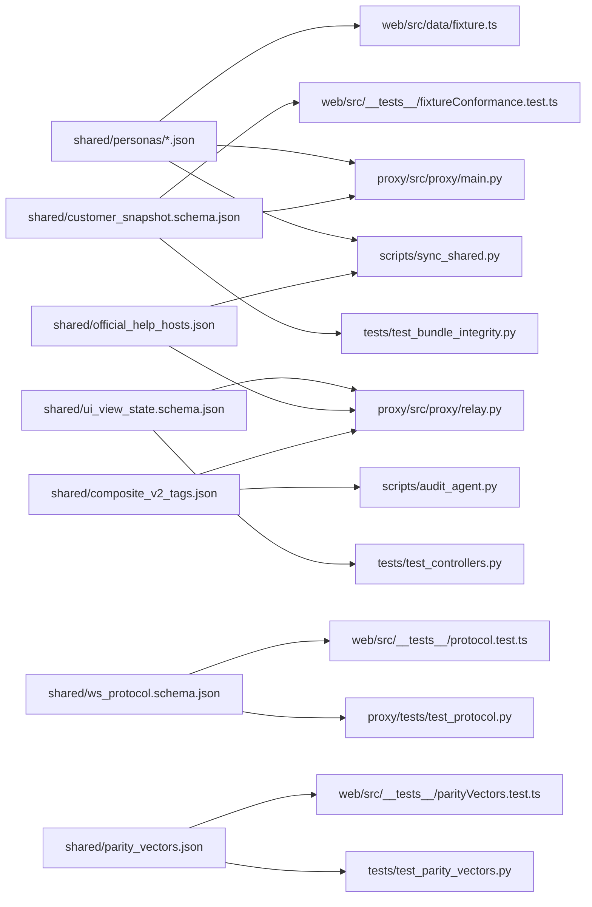

# Cloudbank Engineering Blueprint

This directory contains the CX Agent Studio (GECX) (`CXAS`) bundle, canonical shared callbacks, offline Python test suite, evaluation suites, hardened FastAPI `BidiRunSession` WebSocket proxy, and React 19 + Tailwind CSS v4 Split-Screen web application for **Cloudbank**.

## 1. Hub-and-Spoke Agent Topology

`root_agent` is the entry concierge and sole parent in an acyclic 4-agent tree (`S007`). Sub-agents declare `"childAgents": []` and omit `modelSettings` so every agent inherits `gemini-composite-v2` (`temperature: 1.0`) and `en-GB-Chirp3-HD-Aoede` from `cxas_app/Cloudbank/app.json`.

### Micro-Agent Anatomy

Every agent pairs a concise slot-extraction `instruction.txt` with a single exposed Python controller (sharing pure helpers spliced from `cxas_shared/controller_common.py`) and two byte-identical model callbacks (`8` synced callback files across the `4` agents):

## 2. Agents & Tools Inventory

| Agent Directory | Exposed Controller | Wrapped / Hidden Tools | Responsibility | Silent Route Targets |
| :--- | :--- | :--- | :--- | :--- |
| `agents/root_agent/` | `route_banking_intent` | `end_session` | Greeting, `Home`/`Profile` navigation, capability summary, 2-strike unclear recovery, domain classification, farewell. | `everyday_banking_agent`, `savings_agent`, `mortgage_agent` |
| `agents/everyday_banking_agent/` | `assist_everyday_banking` | `search_help`, `end_session` | Current account balance, 3-month spending, category/vendor drilldown, subscriptions, anomaly check (`yes`/`no`), UK cancellation search + savings redirect offer. | `savings_agent`, `mortgage_agent` |
| `agents/savings_agent/` | `assist_savings` | `end_session` | Savings pot balance, AER vs gross rate, monthly contribution, compound goal projections (consuming `handoff_context.freed_monthly_pence`). | `everyday_banking_agent`, `mortgage_agent` |
| `agents/mortgage_agent/` | `assist_mortgages` | `end_session` | Mortgage summary, next payment, 10% ERC-free allowance, overpayment amortisation savings, integer-bisection fixed-rate renewals, renter readiness (`accounts.mortgage` omitted). | `everyday_banking_agent`, `savings_agent` |

See [`docs/tools/README.md`](../docs/tools/README.md) for function-symbol specifications of all four Python controllers.

## 3. Turn Lifecycle & Callback Chain

| Order | Hook | Callback Path (synced from `cxas_shared/callbacks/` across all 4 agents) | Purpose |
| :--- | :--- | :--- | :--- |
| **1** | `before_model_callbacks` | `before_model_callbacks/capture_utterance/python_code.py` | Isolates `hide_tool` calls (`end_session`, `transfer_to_agent`, `search_help` + post-tool `returned_tool`), short-circuits after `call_complete == "released"`, checks `pass_count <= 8` before Tier 1 return, validates `target_agent` against `_ALLOWED_AGENTS` for silent `Part.from_agent_transfer`, serializes `json.dumps(view)` before stamping `ui_emitted_seq` on Tier 1 `partial=True` `Part.from_json`, and fails closed on unexpected errors. |
| **2** | `after_model_callbacks[0]` | `after_model_callbacks/release_line/python_code.py` | Unified post-model guard: strips forbidden `transfer_to_agent`, `end_session`, and `search_help` calls even in mixed multi-call responses, handles state-only `target_agent` defense-in-depth transfers, guards against `llm_response.partial`, strips case-insensitive `[Diagnosis context: ...]` notes and closed/unclosed `<untrusted_web_snippet>` blocks, ensures spoken fallback text before appending Tier 2 `Part.from_json` or `Part.from_end_session`, and latches `call_complete == "released"`. |

## 4. Session State Contract (`app.json` `variableDeclarations`)

All `OBJECT` variables declare `{"type": "OBJECT", "required": []}` with no `properties` (`V001`), and neither `customer_snapshot` nor `ui_view_state` appears in any prompt (`0` prompt tokens).

| Variable | Type | Writer | Reader | Purpose |
| :--- | :--- | :--- | :--- | :--- |
| `persona_id` | `STRING` | `cloudbank/proxy` (`ClientStart.persona`) | Controllers / Evals | Active persona ID (`chloe`, `david`, `tom`, `sarah`), bound per verified `sessionId`. |
| `first_name` | `STRING` | `cloudbank/proxy` (derived from `snapshot.user.first_name`) | `global_instruction.txt`, `route_banking_intent` | Customer first name derived from the server-owned persona snapshot. |
| `demo_date` | `STRING` | `cloudbank/proxy` (`ClientStart.demoDate`) | `global_instruction.txt`, Controllers | Validated statement anchor date (`YYYY-MM-DD`, default `2026-11-24`). |
| `time_of_day` | `STRING` | `cloudbank/proxy` (`ClientStart.timeOfDay`) | `route_banking_intent` | `morning`, `afternoon` (default), or `evening`. |
| `customer_snapshot` | `OBJECT` | `cloudbank/proxy` (`shared/personas/*.json`) | Spoke controllers | Server-loaded persona fixture in integer `*_pence` and `*_bps` (skipped only on verified active session resumes). |
| `target_agent` | `STRING` | All 4 controllers | `capture_utterance`, `release_line` | Next agent ID for silent callback transfer (`""` once consumed). |
| `handoff_context` | `OBJECT` | `assist_everyday_banking` | `assist_savings`, `assist_mortgages` | One-shot `{from_agent, vendor, freed_monthly_pence}` preserved across domain `switch_intent` hops and cleared on local or `Home`/`Profile` turns. |
| `ui_view_state` | `OBJECT` | All 4 controllers | `capture_utterance`, `release_line`, `relay.py` | Monotonic `{seq, page, ...}` screen state (including per-merchant `anomaly_by_vendor`) synchronised to React. |
| `ui_emitted_seq` | `STRING` | `capture_utterance`, `release_line` | `capture_utterance`, `release_line` | Highest `ui_view_state.seq` emitted on the session (`"0"` initial). |
| `unclear_count` | `STRING` | All 4 controllers | All 4 controllers | Shared 2-strike counter (`"0"` / `"1"`, resets to `"0"` and clears pending flags on Strike 2 without hanging up). |
| `everyday_state` | `OBJECT` | `assist_everyday_banking` | `assist_everyday_banking` | Tracks `pending_anomaly_vendor`, `anomaly_by_vendor`, `pending_redirect_offer`, `last_discussed_subscription`. |
| `mortgage_state` | `OBJECT` | `assist_mortgages` | `assist_mortgages` | Tracks `pending_savings_pivot` for renter deposit-timeline follow-up turns. |
| `pass_turn_id` / `pass_count` | `STRING` | `capture_utterance` | `capture_utterance`, Controllers | Per-invocation loop guard (`_MAX_PASSES = 8`). |
| `call_complete` | `STRING` | All 4 controllers, callbacks | `capture_utterance`, `release_line` | `""` -> `"true"` (farewell staged) -> `"released"` (`end_session` emitted). |
| `escalation_reason` | `STRING` | Controllers, callbacks | `capture_utterance`, `release_line` | Reason attached to `Part.from_end_session` (e.g. `CALL_COMPLETED`). |

## 5. Frozen Cross-Runtime Contracts (`shared/`)

## 6. Testing Pyramid & Engineering Rules

| Layer | Command | What It Verifies |
| :--- | :--- | :--- |
| **1. Sync, Static Lint & Voice Audit** | `sync_shared.py --check`, `cxas lint`, `audit_agent.py`, `ruff check .`, `pyright` | Shared callback/eval sync, schema/prompt/callback rules (`T012`, `E001`-`E011`), `0` warnings, Ruff & Pyright checks, Composite v2 readiness. |
| **2. Offline Python & Proxy Suites** | `uv run --locked pytest -v` (`cloudbank/` & `proxy/`) | Byte-identical callbacks, AST helper parity, `protobuf.Struct` coercion, controller state matrix, server-owned personas, `ws_protocol.schema.json`, loopback/host/semaphore guards. |
| **3. Web Unit, Parity & Build Suite** | `npm test && npm run typecheck && npm run lint && npm run build` | Bundled TypeScript `AudioWorklet` resampling, `sessionMachine.ts` (`ptt` & `continuous`), exact parity vectors, React 19 + Tailwind v4 5-tab UI sync, zero-warning ESLint. |
| **4. Live Proxy Playwright + axe-core E2E** | `make e2e` (`npm run test:e2e`) | Real Chromium over Vite preview + live FastAPI `proxy.main` + loopback `BidiRunSession` test server: Tier 1 UI sync, `GoAway` resume, viewport `<Toast>`, keyboard/voice floor modes, and `0` WCAG 2.1 AA violations. |
| **5. Platform NAIVE Goldens & Sims** | `python scripts/run_golden_evals.py sync` / `run` | Multi-segment turn ordering (`toolCall -> agentResponse -> agentTransfer`) and goal-oriented `SimulationEvals` in `evals/`. |

### DO / DO NOT Cheatsheet

- **DO** store all money in integer `*_pence` and rates in integer `*_bps`, using integer `half_up(n, d)` and integer bisection.
- **DO** stage agent transfers exclusively via `context.state["target_agent"]`, edit shared callbacks in `cxas_shared/callbacks/`, shared controller helpers in `cxas_shared/controller_common.py`, official help hosts in `shared/official_help_hosts.json`, and personas in `shared/personas/*.json`, then run `uv run --locked python scripts/sync_shared.py --write`.
- **DO** deploy via `./push.sh --yes` (`OVERWRITE` import via `scripts/manage_app.py` + orphan tool check + `run_golden_evals.py sync`) using gitignored `gecx-config.json` (copied from `gecx-config.example.json`) or `CLOUDBANK_*` environment variables.
- **DO NOT** reference `{customer_snapshot}` or `{ui_view_state}` in any prompt, use `{@AGENT: ...}` tokens, or expose `transfer_to_agent`, `end_session`, or `search_help` to the model.
- **DO NOT** run `cxas push-eval` (it mis-orders multi-agent transfer steps) or bind `cloudbank/proxy` to `0.0.0.0`.
