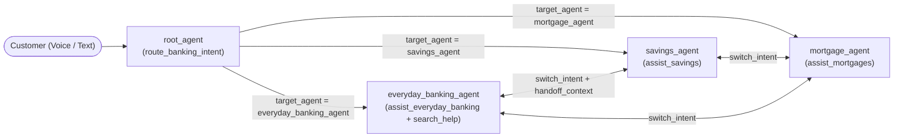
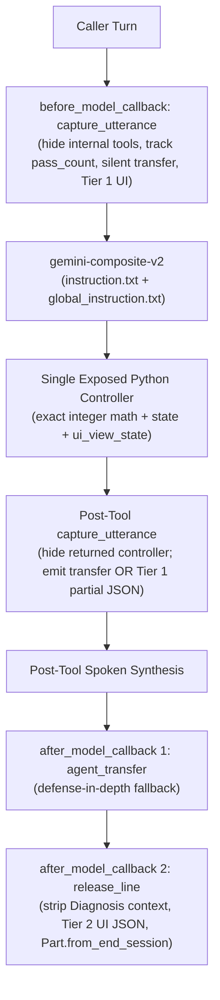
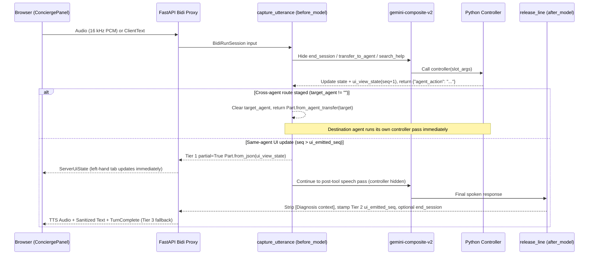
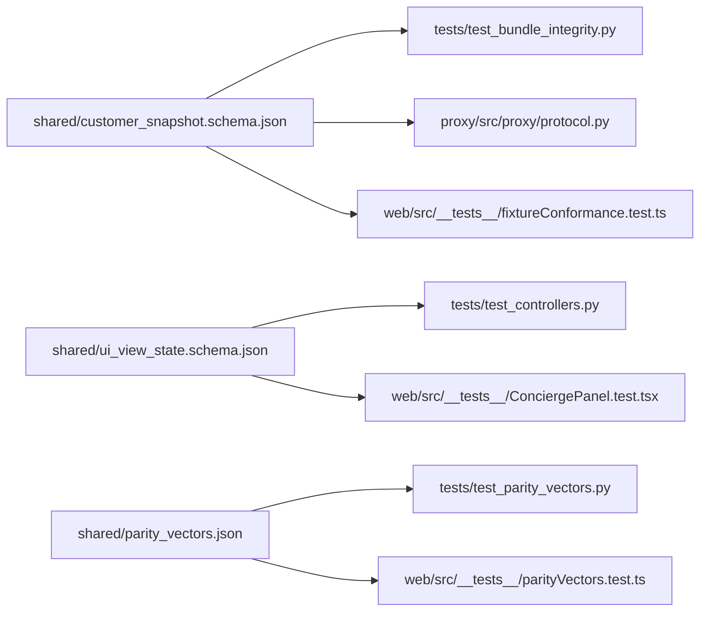

# Cloudbank Engineering Blueprint

This directory contains the CX Agent Studio (`CXAS`) bundle, offline Python test suite, evaluation suites, Bidi WebSocket proxy, and React Split-Screen web application for **Cloudbank**.

## 1. Hub-and-Spoke Agent Topology

`root_agent` is the entry concierge and sole parent in an acyclic 4-agent tree (`S007`). Sub-agents declare `"childAgents": []` and omit `modelSettings` so every agent inherits `gemini-composite-v2` (`temperature: 1.0`) and `en-GB-Chirp3-HD-Aoede` from `cxas_app/Cloudbank/app.json`.

### Micro-Agent Anatomy

Every agent pairs a concise slot-extraction `instruction.txt` with a single exposed Python controller and three byte-identical model callbacks:

## 2. Agents & Tools Inventory

| Agent Directory | Exposed Controller | Wrapped / Hidden Tools | Responsibility | Silent Route Targets |
| :--- | :--- | :--- | :--- | :--- |
| `agents/root_agent/` | `route_banking_intent` | `end_session` | Greeting, `Home`/`Profile` navigation, capability summary, 2-strike unclear recovery, domain classification, farewell. | `everyday_banking_agent`, `savings_agent`, `mortgage_agent` |
| `agents/everyday_banking_agent/` | `assist_everyday_banking` | `search_help`, `end_session` | Current account balance, 3-month spending, category/vendor drilldown, subscriptions, anomaly check (`yes`/`no`), UK cancellation search + savings redirect offer. | `savings_agent`, `mortgage_agent` |
| `agents/savings_agent/` | `assist_savings` | `end_session` | Savings pot balance, AER vs gross rate, monthly contribution, compound goal projections (consuming `handoff_context.freed_monthly_pence`). | `everyday_banking_agent`, `mortgage_agent` |
| `agents/mortgage_agent/` | `assist_mortgages` | `end_session` | Mortgage summary, next payment, 10% ERC-free allowance, overpayment amortisation savings, integer-bisection fixed-rate renewals, renter readiness (`mortgage: null`). | `everyday_banking_agent`, `savings_agent` |

See [`docs/tools/README.md`](../docs/tools/README.md) for line-linked specifications of all four Python controllers.

## 3. Turn Lifecycle & Callback Chain

| Order | Hook | Callback Path (identical across all 4 agents) | Purpose |
| :--- | :--- | :--- | :--- |
| **1** | `before_model_callbacks` | `before_model_callbacks/capture_utterance/python_code.py` | Short-circuits after `call_complete == "released"`, hides `end_session` / `transfer_to_agent` / `search_help`, bounds `pass_count ≤ 8`, hides `returned_tool` on post-tool pass, executes silent `Part.from_agent_transfer`, or emits Tier 1 `partial=True` `Part.from_json`. |
| **2** | `after_model_callbacks[0]` | `after_model_callbacks/agent_transfer/python_code.py` | Defense-in-depth: if `target_agent` remains non-empty after a non-tool response, clears it and emits `Part.from_agent_transfer`. |
| **3** | `after_model_callbacks[1]` | `after_model_callbacks/release_line/python_code.py` | Strips any leaked `end_session` call or `[Diagnosis context: ...]` note, re-stamps `ui_emitted_seq` on the persisted pass (appending Tier 2 `Part.from_json` when `seq > prev_emitted_seq`), and appends `Part.from_end_session` when `call_complete == "true"`. |

## 4. Session State Contract (`app.json` `variableDeclarations`)

All `OBJECT` variables declare `{"type": "OBJECT", "required": []}` with no `properties` (`V001`), and neither `customer_snapshot` nor `ui_view_state` appears in any prompt (`0` prompt tokens).

| Variable | Type | Writer | Reader | Purpose |
| :--- | :--- | :--- | :--- | :--- |
| `persona_id` | `STRING` | Browser (`ClientStart`) | Controllers / Evals | Active persona ID (`chloe`, `david`, `tom`, `sarah`). |
| `first_name` | `STRING` | Browser (`ClientStart`) | `global_instruction.txt`, `route_banking_intent` | Customer first name for natural greeting. |
| `demo_date` | `STRING` | Browser (`ClientStart`) | `global_instruction.txt`, Controllers | Anchored statement date (`YYYY-MM-DD`, default `2026-11-24`). |
| `time_of_day` | `STRING` | Browser (`ClientStart`) | `route_banking_intent` | `morning`, `afternoon`, or `evening`. |
| `customer_snapshot` | `OBJECT` | Browser (`ClientStart`) | Spoke controllers | Verbatim persona fixture in integer `*_pence` and `*_bps`. |
| `target_agent` | `STRING` | All 4 controllers | `capture_utterance`, `agent_transfer` | Next agent ID for silent callback transfer (`""` once consumed). |
| `handoff_context` | `OBJECT` | `assist_everyday_banking` | `assist_savings`, `assist_mortgages` | One-shot `{from_agent, vendor, freed_monthly_pence}` cleared on entry. |
| `ui_view_state` | `OBJECT` | All 4 controllers | `capture_utterance`, `release_line`, `relay.py` | Monotonic `{seq, page, ...}` screen state synchronised to React. |
| `ui_emitted_seq` | `STRING` | `capture_utterance`, `release_line` | `capture_utterance`, `release_line` | Highest `ui_view_state.seq` emitted on the session (`"0"` initial). |
| `unclear_count` | `STRING` | All 4 controllers | All 4 controllers | Shared 2-strike counter (`"0"` / `"1"`, resets to `"0"` on Strike 2 without hanging up). |
| `router_state` | `OBJECT` | `route_banking_intent` | `route_banking_intent` | `{last_intent, topic_hint}` recorded on hub classification. |
| `everyday_state` | `OBJECT` | `assist_everyday_banking` | `assist_everyday_banking` | Tracks `pending_anomaly_vendor`, `anomaly_status`, `pending_redirect_offer`, `last_discussed_subscription`. |
| `savings_state` | `OBJECT` | `assist_savings` | `assist_savings` | Tracks `last_extra_monthly_pence` and `last_custom_target_pence`. |
| `mortgage_state` | `OBJECT` | `assist_mortgages` | `assist_mortgages` | Tracks `last_subview`, `last_monthly_overpayment_pence`, `last_lump_sum_overpayment_pence`. |
| `pass_turn_id` / `pass_count` | `STRING` | `capture_utterance` | `capture_utterance` | Per-invocation loop guard (`_MAX_PASSES = 8`). |
| `last_user_utterance` | `STRING` | `capture_utterance` | Diagnostics | Latest cleaned caller utterance (`≤ 500` chars). |
| `call_complete` | `STRING` | All 4 controllers, callbacks | `capture_utterance`, `release_line` | `""` → `"true"` (farewell staged) → `"released"` (`end_session` emitted). |
| `escalation_reason` | `STRING` | Controllers, callbacks | `capture_utterance`, `release_line` | Reason attached to `Part.from_end_session` (e.g. `CALL_COMPLETED`). |

## 5. Frozen Cross-Runtime Contracts (`shared/`)

## 6. Testing Pyramid & Engineering Rules

| Layer | Command | What It Verifies |
| :--- | :--- | :--- |
| **1. Static Lint & Voice Audit** | `uv run --locked cxas lint` & `audit_agent.py` | Schema/prompt/callback rules (`T012`, `E001`–`E011`), `0` warnings, Composite v2 voice/guardrail readiness. |
| **2. Offline Python & Proxy Suites** | `uv run --locked pytest -v` (`cloudbank/` & `proxy/`) | Byte-identical callbacks, AST bans on float math, `protobuf.Struct` coercion, controller state matrix, proxy CSWSH/schema/keepalive. |
| **3. Web Unit, Parity & UI Suite** | `npm test && npm run typecheck && npm run lint && npm run build` | Cross-rate `AudioWorklet` resampling, 11-row `sessionMachine.ts`, exact parity vectors, 5-tab UI sync, executive `ConciergePanel` hygiene. |
| **4. Platform NAIVE Goldens & Sims** | `python scripts/run_golden_evals.py sync` / `run` | Multi-segment turn ordering (`toolCall → agentResponse → agentTransfer`) and goal-oriented `SimulationEvals` in `evals/`. |

### DO / DO NOT Cheatsheet

- **DO** store all money in integer `*_pence` and rates in integer `*_bps`, using integer `half_up(n, d)` and integer bisection.
- **DO** stage agent transfers exclusively via `context.state["target_agent"]` and copy any callback change across all four agents.
- **DO** deploy via `./push.sh` (`OVERWRITE` import + orphan tool check + `run_golden_evals.py sync`) and read project/location from `gecx-config.json`.
- **DO NOT** reference `{customer_snapshot}` or `{ui_view_state}` in any prompt, use `{@AGENT: ...}` tokens, or expose `transfer_to_agent` / `end_session` to the model.
- **DO NOT** run `cxas push-eval` (it mis-orders multi-agent transfer steps) or bind `cloudbank/proxy` to `0.0.0.0`.
