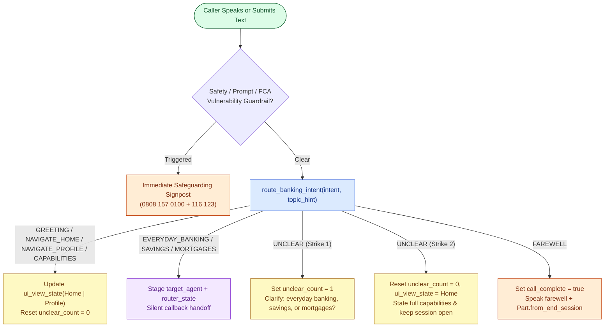
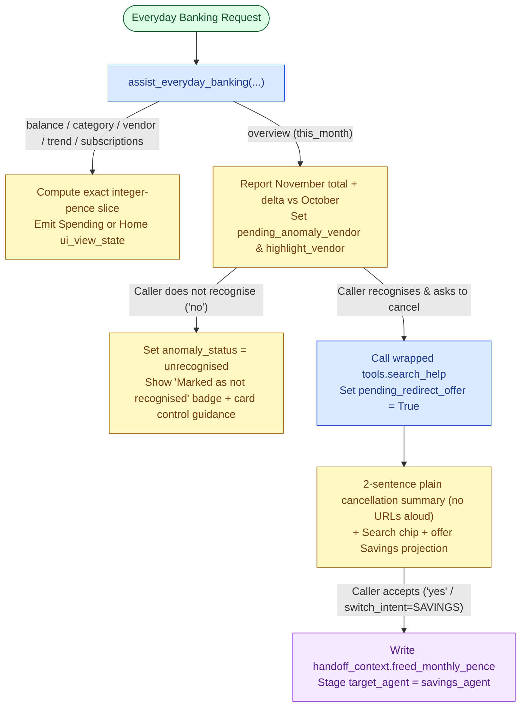
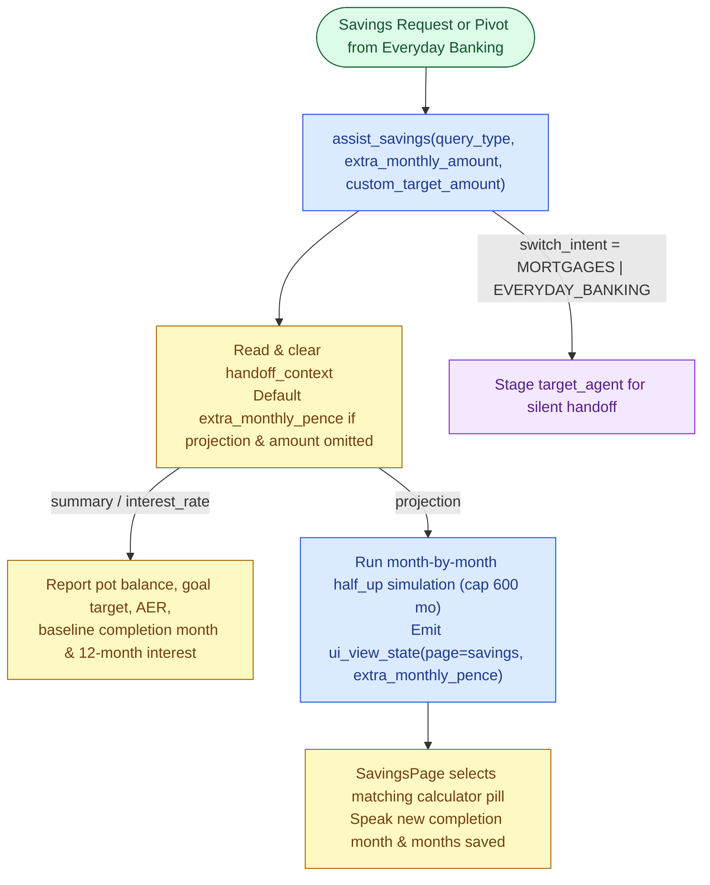
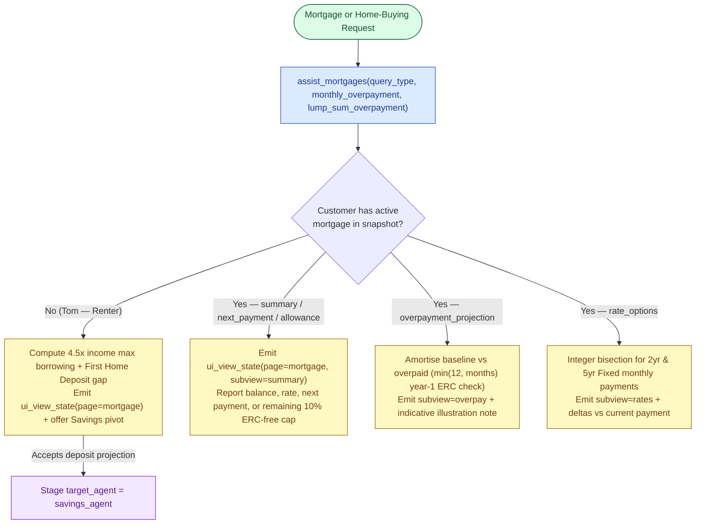

# Retail Banking Journeys & Conversational Flows

Cloudbank covers four interconnected retail banking domains plus three immediate customer-safeguarding guardrails. Every flow synchronises the left-hand 5-tab banking screen (`Home`, `Spending`, `Savings`, `Mortgage`, `Profile`) with the spoken or written answer in the right-hand **Cloudbank Concierge** panel.

> **Diagram Colour Key:** Green = Caller Entry · Blue = Python Controller / Search Step · Yellow = Session State & Screen Sync · Purple = Silent Specialist Handoff · Orange = Session Close or Safeguarding Escalation.

## 1. Customer Profiles Covered

| Persona | Profile | Current Account | Savings Pot | Mortgage / Home Buying | Flagged November Anomaly |
| :--- | :--- | :--- | :--- | :--- | :--- |
| **Chloe** | Homeowner | `£2,840.50` | `Home Emergency Pot` (`£4,850` / `£10,000` at `4.50% AER`) | `£214,500` at `4.20%` (`220` mo, `£21,450` ERC-free left) | Netflix `£45.00` on 21 Nov (was `£17.99`) |
| **David** | Remortgager | `£4,120.80` | `Family Holiday Fund` (`£10,800` / `£18,000` at `4.75% AER`) | `£158,200` at `3.95%` (`120` mo, `£13,620` ERC-free left) | PureGym Family `£62.00` on 22 Nov (was `£38.00`) |
| **Tom** | First-Time Buyer (Rents) | `£1,650.25` | `First Home Deposit` (`£14,200` / `£35,000` at `4.65% AER`) | Renter (`£42,000` income → `£189,000` `4.5×` borrowing) | Adobe Creative Cloud `£199.00` on 22 Nov (was `£54.99`) |
| **Sarah** | Pre-Retirement | `£6,490.10` | `Retirement Bridge Pot` (`£21,500` / `£25,000` at `4.40% AER`) | `£96,500` at `3.85%` (`90` mo, `£3,650` ERC-free left) | Aviva Home Insurance `£96.00` on 23 Nov (was `£48.00`) |

---

## 2. Concierge Entry, Navigation & Non-Terminating Unclear Ladder

---

## 3. Everyday Banking, Anomaly Confirmation & Subscription Pivot

When a monthly spending overview includes an unconfirmed flagged charge (`is_anomaly: true`), the assistant highlights the transaction row on the **Spending** tab and asks whether the customer recognises it. Confirming (`yes`) or asking how to cancel invokes wrapped Google Search (`search_help`) and offers to project redirecting the freed monthly subscription cost into **Savings**. Saying `no` marks the row on screen as `"Marked as not recognised"` without claiming a backend fraud dispute has already been filed, and never treats disputed money as freed savings.

---

## 4. Savings Pot & Monthly Compound Goal Projections

---

## 5. Mortgage Overpayments, Renewal Comparison & Renter Readiness

---

## 6. Immediate Safeguarding & Vulnerability Guardrails

All three guardrails are configured on `app.json` (`guardrails`) with `respondImmediately` short-circuit actions so sensitive turns never reach open-ended generation:

1. **`fca_vulnerability_guardrail`:** Detects bereavement, domestic or financial abuse, severe illness, job loss, or self-harm/distress cues and responds immediately with warm UK safeguarding support — Cloudbank Specialist Support (`0808 157 0100`, an Ofcom drama-reserved Freephone range safe for demonstrations) and Samaritans (`116 123`, free 24/7).
2. **`prompt_security_guardrail`:** Blocks prompt injection, system-instruction extraction, and tool/variable override attempts.
3. **`model_safety_guardrail`:** Enforces platform safety thresholds across hate speech, dangerous content, harassment, and sexually explicit content.
