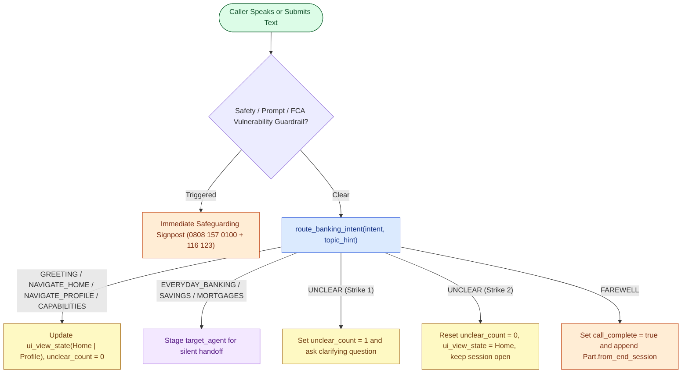
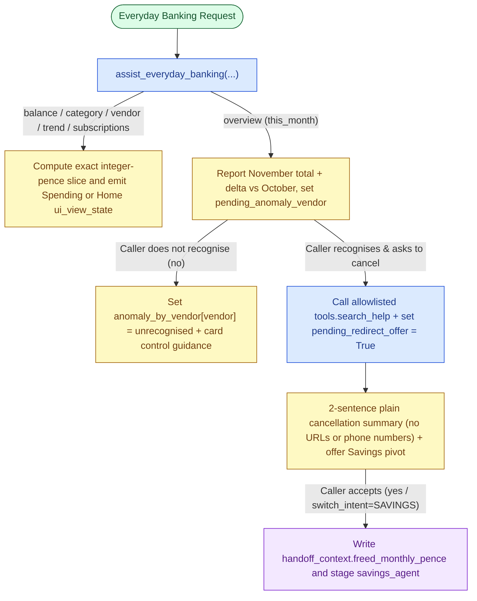
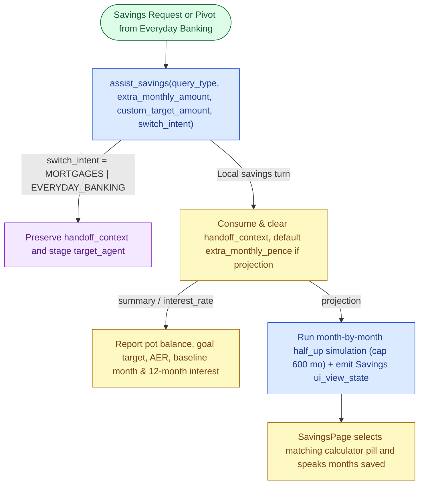

# Retail Banking Journeys & Conversational Flows

Cloudbank covers four interconnected retail banking domains plus three immediate customer-safeguarding guardrails. Every flow synchronises the left-hand 5-tab banking screen (`Home`, `Spending`, `Savings`, `Mortgage`, `Profile`) via `BankingViewStateProvider` with the spoken or written answer in the right-hand **Cloudbank Concierge** panel.

> Diagram Colour Key: Green = Caller Entry · Blue = Python Controller / Search Step · Yellow = Session State & Screen Sync · Purple = Silent Specialist Handoff · Orange = Session Close or Safeguarding Escalation.

## 1. Customer Profiles Covered

Canonical persona snapshots live on the server at `cloudbank/shared/personas/{chloe,david,tom,sarah}.json`:

| Persona | Profile | Current Account | Savings Pot | Mortgage / Home Buying | Flagged November Anomaly |
| :--- | :--- | :--- | :--- | :--- | :--- |
| **Chloe** | Homeowner | `£4,250.75` | `Home Emergency Pot` (`£4,850` / `£10,000` at `4.50% AER`, `£200/mo`) | `£214,500` at `4.20%` (`220` mo, `£21,450` ERC-free left) | Netflix `£45.00` on 21 Nov (was `£17.99`) |
| **David** | Remortgager | `£6,820.40` | `Family Reserve Pot` (`£12,400` / `£18,000` at `4.25% AER`, `£300/mo`) | `£148,200` at `3.90%` (`120` mo, `£13,620` ERC-free left) | PureGym Family `£62.00` on 22 Nov (was `£38.00`) |
| **Tom** | First-Time Buyer (Rents) | `£1,840.50` | `First Home Deposit` (`£14,200` / `£35,000` at `4.75% AER`, `£350/mo`) | Renter (`£42,000` income -> `£189,000` `4.5×` borrowing) | Adobe Creative Cloud `£199.00` on 22 Nov (was `£54.99`) |
| **Sarah** | Pre-Retirement | `£9,340.15` | `Retirement Emergency Reserve` (`£21,500` / `£25,000` at `4.50% AER`, `£400/mo`) | `£96,500` at `4.05%` (`90` mo, `£3,650` ERC-free left) | Aviva Home Insurance `£96.00` on 23 Nov (was `£48.00`) |

---

## 2. Concierge Entry, Navigation & Non-Terminating Unclear Ladder

---

## 3. Everyday Banking, Per-Vendor Anomaly Check & Allowlisted Subscription Pivot

When a monthly spending overview includes an unconfirmed flagged charge (`is_anomaly: true`), the assistant highlights the transaction row on **Spending** and asks whether the customer recognises it. Recognition status is stored per merchant in `anomaly_by_vendor` and emitted inside `ui_view_state` so confirming or disputing one merchant scopes its badge strictly to that merchant row without affecting any other flagged rows. Confirming (`yes`) or asking how to cancel a canonical subscription invokes wrapped Google Search (`search_help`) against an exact `https://` official vendor help-host allowlist (`cloudbank/shared/official_help_hosts.json`, enforced on outbound UI citation chips in `relay.py` as well), strips phone numbers, email addresses, and URLs, wraps text inside `<untrusted_web_snippet>`, and offers to project redirecting the freed monthly subscription cost into **Savings**. Saying `no` (whether on a standalone `anomaly_followup`, alongside `cancel_subscription` such as *"I don't recognise that, how do I cancel it?"*, or deferred alongside `overview` / `balance`) always marks that merchant `"unrecognised"` in `anomaly_by_vendor` (`"Marked as not recognised"` on screen), surfaces card-freeze guidance on **Profile** without claiming a backend fraud dispute has already completed, and never marks an unrecognised charge `"confirmed"` or offers disputed funds as freed savings.

---

## 4. Savings Pot & Monthly Compound Goal Projections

---

## 5. Mortgage Overpayments, Renewal Comparison & Renter Readiness

```mermaid
flowchart TD
    classDef entry fill:#dcfce7,stroke:#166534,color:#14532d;
    classDef ctrl fill:#dbeafe,stroke:#1d4ed8,color:#1e3a8a;
    classDef state fill:#fef9c3,stroke:#a16207,color:#713f12;
    classDef route fill:#f3e8ff,stroke:#7e22ce,color:#581c87;

    In(["Mortgage or Home-Buying Request"]):::entry --> Mtg["assist_mortgages(query_type, monthly_overpayment, lump_sum_overpayment, confirm_pivot, switch_intent)"]:::ctrl
    Mtg --> HasMtg{"Customer has active mortgage in snapshot?"}
    HasMtg -->|"No (Tom, Renter)"| Rent["Compute 4.5x income max borrowing + First Home Deposit gap, arm pending_savings_pivot"]:::state
    Rent -->|"confirm_pivot = yes / switch_intent = SAVINGS"| ToSav["Stage target_agent = savings_agent"]:::route
    Rent -->|"confirm_pivot = no"| Decline["Clear pending_savings_pivot and offer general banking help"]:::state
    HasMtg -->|"Yes: summary / next_payment / overpayment_allowance"| Summary["Emit ui_view_state(page=mortgage, subview=overview) + report figures"]:::state
    HasMtg -->|"Yes: overpayment_projection"| Overpay["Amortise baseline vs overpaid (year-1 ERC check) + emit subview=overpay"]:::state
    HasMtg -->|"Yes: rate_options"| Rates["Integer bisection for 2yr & 5yr Fixed monthly payments + emit subview=rates"]:::state
```

---

## 6. Immediate Safeguarding & Vulnerability Guardrails

All three guardrails are configured on `app.json` (`guardrails`) with `respondImmediately` short-circuit actions so sensitive turns never reach open-ended generation:

1. `fca_vulnerability_guardrail` (`failOpen: false`): detects self-harm or suicidal thoughts, domestic or financial coercion or abuse, acute bereavement crisis, or inability to afford essentials (food, heating, or housing) and responds immediately with warm UK safeguarding support, naming Cloudbank Specialist Support (`0808 157 0100`, an Ofcom drama-reserved Freephone range safe for demonstrations) and Samaritans (`116 123`, free 24/7).
2. `prompt_security_guardrail`: blocks prompt injection, system-instruction extraction, and tool or variable override attempts on incoming queries.
3. `model_safety_guardrail`: enforces platform safety thresholds across hate speech, dangerous content, harassment, and sexually explicit content.
