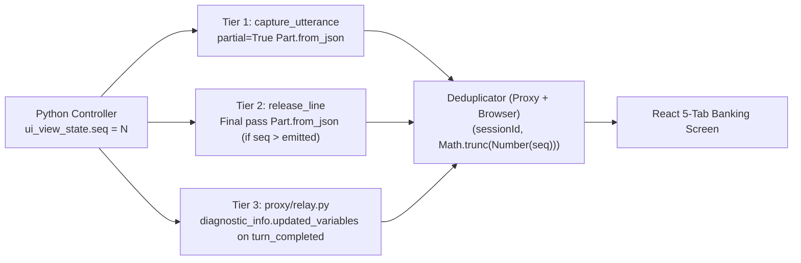

# Bidi UI Synchronisation, Audio Runtime & Executive Concierge Panel

Cloudbank synchronises a 5-tab retail banking screen (`Home`, `Spending`, `Savings`, `Mortgage`, `Profile`) with a clean right-hand **Cloudbank Concierge** conversation panel over a single localhost `BidiRunSession` WebSocket.

---

## 1. Three-Tier Monotonic `ui_view_state` Synchronisation

Rather than round-tripping browser `clientFunction` calls (which couple screen updates to browser availability and add extra model passes), Python controllers increment `context.state["ui_view_state"]["seq"]` monotonically (`1, 2, 3, ...`) and emit state through three complementary tiers:

1. **Tier 1 (`capture_utterance` on `_is_tool_response`):** Immediately after hiding the returned controller (when no `target_agent` transfer is staged and `session_id` does not start with `"evaluation"`), stamps `ui_emitted_seq = str(seq)` and returns a `partial = True` `LlmResponse` carrying `Part.from_json(data=json.dumps(view))` so the browser can switch tabs and calculator pills while the post-tool spoken response is still being generated. Controlled by `_ENABLE_TIER1_PARTIAL_UI = True`.
2. **Tier 2 (`release_line` in `after_model_callback`):** Re-stamps `ui_emitted_seq` on the persisted final model pass and appends `Part.from_json` whenever `seq > prev_emitted_seq` (covering turns when `_ENABLE_TIER1_PARTIAL_UI` is disabled or skipped).
3. **Tier 3 (`cloudbank/proxy/src/proxy/relay.py` fallback):** Inspects `session_output.diagnostic_info.messages[].chunks[].updated_variables` on `turn_completed=True` and emits `ServerUiState(tier=3)` if `seq` has not yet been forwarded for the active `sessionId`.

Both `relay.py` and `sessionMachine.ts` deduplicate `ui_view_state` by `(sessionId, Math.trunc(Number(seq)))` and reset the cursor on `ServerReady` (`ready`) and `PERSONA_SWITCH`.

---

## 2. Cross-Rate `16 kHz` `AudioWorklet` & Trailing Endpointer Silence

Browser `AudioContext` instances run at the operating system's native hardware sample rate (typically `44.1 kHz` or `48 kHz`), whereas `BidiRunSession` expects `16 kHz` 16-bit mono `LINEAR16` PCM (`InputAudioConfig`):

- **Hardware-Rate Graph + Stateful Downsampler:** `audio.ts` opens `new AudioContext()` at native hardware rate so `createMediaStreamSource(stream)` never throws cross-rate `NotSupportedError`. Both `public/audio-worklet.js` and `src/agent/resampler.ts` run a stateful fractional-phase box-averaging downsampler across 128-sample render quanta, emitting `1,600`-sample (`100 ms`) `Int16` chunks.
- **Immediate Flush Before Trailing Silence:** When the user releases **Hold to talk** (`PTT_RELEASE`), the worklet flushes any remaining spoken sub-100 ms PCM tail **before** `audio.ts` streams `100 ms` silence frames (up to `2,500 ms`, stopping immediately as soon as the server sends a final transcript, `ui_state`, audio, text, `interrupt`, or `turn_complete`). Once silent, the proxy's 10-second `LINEAR16` keepalive maintains the upstream stream up to `PROXY_MAX_IDLE_SECONDS` (`900 s`).

---

## 3. Pure 11-Row Frontend `sessionMachine.ts`

All WebSocket, microphone, audio-playback, and persona transitions live in the pure reducer `cloudbank/web/src/agent/sessionMachine.ts`:

| Row | Scenario | Deterministic Transition |
| :--- | :--- | :--- |
| **1** | Deliberate PTT barge-in during `agentSpeaking` | Flushes `AudioPlayer`, increments `playbackEpoch` to drop in-flight audio frames, marks active assistant turn `interrupted: true` (`(Interrupted)`), starts capture. |
| **2** | `turn_complete` arrives while TTS buffer is still playing | Sets `turnCompletedWhileSpeaking = true` and stays in `agentSpeaking` until `PLAYER_DRAINED` fires for the matching `playbackEpoch`. |
| **3** | Text/silent turn with zero audio chunks | Transitions `thinking → ready` on `turn_complete`; guarded by a `15,000 ms` `THINKING_WATCHDOG` timer. |
| **4** | `ServerEnd` (`end_session` on farewell) | Enters `drainingFarewell` while TTS plays (`relay.py` also flushes held `ServerEnd` on upstream close), transitioning to `ended` once `PLAYER_DRAINED` completes; holding PTT during drain flushes audio and starts a fresh session. |
| **5** | Normal WebSocket close after `ServerEnd` | Treated as expected completion (`ended`), never triggering an error state. |
| **6** | `ServerGoAway` before upstream deadline | Reconnects resuming the same `sessionId` (deferred until `PLAYER_DRAINED` if `agentSpeaking`, and re-arming mic capture if held). |
| **7** | Stale events from a superseded WebSocket | Dropped via monotonically increasing `connectionEpoch`. |
| **8** | React 18 `StrictMode` double-mount | Deferred macrotask teardown reuses the single initial socket without duplicate handshakes. |
| **9** | Microphone permission blocked (`NotAllowedError`) | Keeps the open WebSocket alive, displays calm microphone-permission guidance in `ConciergePanel` with live text input active, and retries mic capture cleanly on the next hold. |
| **10** | Keyboard Spacebar repeat / window blur | Ignores `event.repeat` keydowns and dispatches `PTT_RELEASE` on `window` `blur` or `visibilitychange`. |
| **11** | `PERSONA_SWITCH` or text-bar `CLIENT_TEXT_SUBMIT` | `PERSONA_SWITCH` closes the active socket, resets UI/turns/`seenUiSeqKey`, and opens a new session for the selected customer; `CLIENT_TEXT_SUBMIT` barges in cleanly or connects-then-sends if disconnected/paused/ended. |

> **Note on `bargeInAwareness: true`:** When a caller interrupts speech mid-sentence, CES tells the model on the next turn that its prior response was interrupted so it can adapt naturally; the `(Interrupted)` label in `ConciergePanel` marks the turn boundary rather than the exact millisecond syllable cut-off.

---

## 4. Executive Split-Screen Layout & `ConciergePanel`

`WorkbenchLayout.tsx` pairs the 5-tab banking app on the left with `ConciergePanel.tsx` on the right on a warm stone canvas (`#f7f6f2`), unified `#ffffff` surfaces, and `1px #e5e3dc` hairlines (zero drop-shadows and zero technical telemetry on screen):

- **Plain-English Domain Pill:** Maps active specialist state to at most one subtle header pill (`Everyday Banking`, `Savings`, or `Mortgages`) — never exposing internal `snake_case` agent IDs, tool names, model IDs, or sequence numbers.
- **Stream Sanitizer (`streamSanitizer.ts`):** `sanitizeAgentProse` strips inline Composite v2 audio tags (`<warm>`, `<reassuring>`, etc.), platform XML envelopes, and `[Diagnosis context: ...]` notes while `appendOrUpdateAssistantText` in `sessionMachine.ts` accumulates both cumulative and per-segment `ServerText` frames across multi-agent turns.
- **Sandboxed Google Search Chips:** Renders `SessionOutput.google_search_suggestions` HTML inside `<iframe sandbox="allow-popups allow-popups-to-escape-sandbox">` (scripts disabled) alongside `http(s)`-validated citation links.

---

## 5. Live `locations/eu` Verification Spike Checklist

Because offline unit tests exercise simulated gRPC/WebSocket streams, run the following empirical checks when validating against a live CX Agent Studio app in `locations/eu`:

1. **Tier 1 `partial=True` arrival timing (`A1`):** Verify in browser network frames whether Tier 1 `Part.from_json` arrives ahead of the first TTS audio chunk on `gemini-composite-v2` in `locations/eu`, and confirm zero duplicate spoken synthesis; if any platform quirk appears, set `_ENABLE_TIER1_PARTIAL_UI = False` in the callbacks so Tier 2 and Tier 3 carry `ui_view_state` seamlessly.
2. **Live `SessionOutput.text` framing (`W-2`):** Confirm whether `gemini-composite-v2` emits cumulative or per-segment `SessionOutput.text` frames across post-transfer turns and pacing-phrase turns (`appendOrUpdateAssistantText` handles both modes).
3. **Farewell TTS drain on live CES (`Row 4`):** Confirm the full spoken farewell plays to completion before `ended` is reached when `Part.from_end_session` is appended by `release_line`.
4. **Endpointer reaction latency (`A4`):** Confirm post-release turn latency with the immediate worklet tail flush + `≤ 2.5 s` silence cap across `44.1 kHz` and `48 kHz` microphones.
