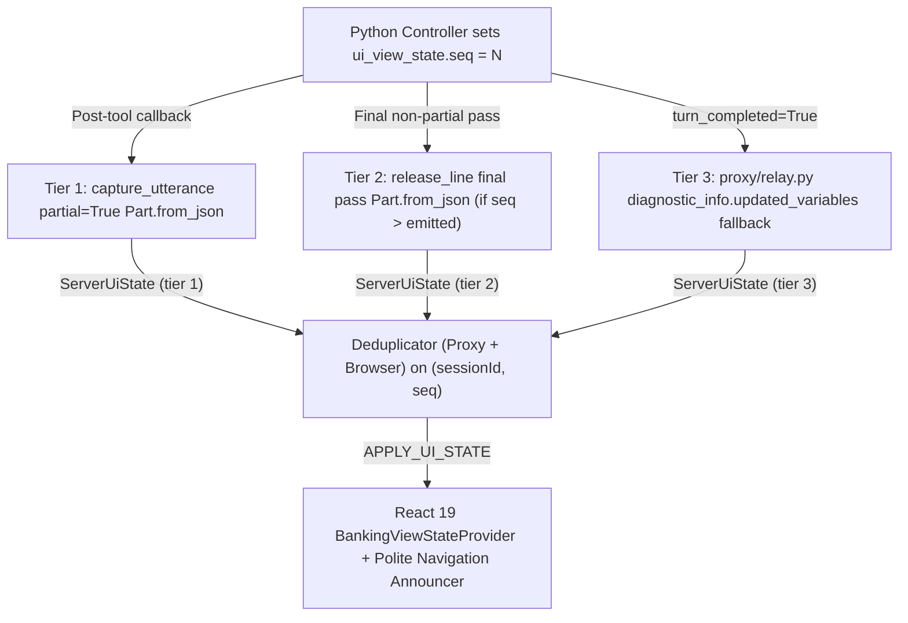

# Bidi UI Synchronisation, Audio Runtime & Accessible Concierge Workbench

Cloudbank synchronises a 5-tab retail banking screen (`Home`, `Spending`, `Savings`, `Mortgage`, `Profile`) managed by `BankingViewStateProvider` with the right-hand **Cloudbank Concierge** conversation panel over a single localhost `BidiRunSession` WebSocket validated against `cloudbank/shared/ws_protocol.schema.json`.

---

## 1. Three-Tier Monotonic `ui_view_state` Synchronisation

Rather than round-tripping browser `clientFunction` calls (which couple screen updates to browser availability and add extra model passes), Python controllers increment `context.state["ui_view_state"]["seq"]` monotonically (`1, 2, 3, ...`) and emit state through three complementary tiers:

1. Tier 1 (`capture_utterance` on `_is_tool_response`): immediately after hiding the returned controller (when no `target_agent` transfer is staged and `session_id` does not start with `"evaluation"`), stamps `ui_emitted_seq = str(seq)` and returns a `partial = True` `LlmResponse` carrying `Part.from_json(data=json.dumps(view))` so the browser switches tabs and calculator pills while the post-tool spoken response is still being generated (`_ENABLE_TIER1_PARTIAL_UI = True`).
2. Tier 2 (`release_line` in `after_model_callback`): guards against `llm_response.partial` streaming chunks first, then re-stamps `ui_emitted_seq` on the persisted final model pass and appends `Part.from_json` whenever `seq > prev_emitted_seq`.
3. Tier 3 (`cloudbank/proxy/src/proxy/relay.py` fallback): inspects `session_output.diagnostic_info.messages[].chunks[].updated_variables` on `turn_completed=True` and emits `ServerUiState(tier=3)` if `seq` exceeds `_max_ui_seq` for the active session.

Both `relay.py` and `sessionMachine.ts` deduplicate `ui_view_state` by `(sessionId, Math.trunc(Number(seq)))`. When `ServerGoAway` resumes on the same `sessionId`, the browser sends `lastUiSeq` in `ClientStart` and preserves `seenUiSeqKey.maxSeq` on `ServerReady` so Tier 3 `updatedVariables` never replay stale tab transitions after a reconnect; switching personas or starting a new `sessionId` resets the cursor cleanly.

---

## 2. Bundled TypeScript `AudioWorklet`, Native Playback Rate & Floor Control

Browser `AudioContext` instances run at the operating system's native hardware sample rate (typically `44.1 kHz` or `48 kHz`), whereas `BidiRunSession` expects `16 kHz` 16-bit mono `LINEAR16` PCM (`InputAudioConfig`):

- Bundled TypeScript Worklet & Transferable Buffers: `audio.ts` loads a Vite-bundled TypeScript `pcm-capture` `AudioWorklet` running a stateful fractional-phase box-averaging downsampler across 128-sample render quanta, emitting `1,600`-sample (`100 ms`) `Int16` chunks with zero-copy `postMessage(out, [out.buffer])` transfers and guarding against capture leaks if `STOP_MIC_CAPTURE` arrives while `getUserMedia` is still pending.
- Native Hardware Playback Rate & Odd-Byte Guards: `createAudioPlayer` opens its playback `AudioContext` at the browser's native hardware rate while decoding `24,000 Hz` TTS PCM into `createBuffer(1, samples.length, 24000)`, surfacing audio initialisation failures cleanly and guarding `base64Pcm16ToFloat32` (as well as `AudioFrame` in `cloudbank/proxy`) against empty or odd-byte PCM payloads.
- Immediate Flush Before Trailing Silence: when the user ends speech capture (`PTT_RELEASE`), the worklet flushes any remaining sub-100 ms PCM tail before `audio.ts` streams `100 ms` silence frames (up to `2,500 ms`, stopping on the first server transcript, `ui_state`, audio, text, `interrupt`, or `turn_complete`). Once silent, the proxy's 10-second `LINEAR16` keepalive maintains the upstream stream up to `PROXY_MAX_IDLE_SECONDS` (`900 s`).
- Accessible Floor Modes (`inputMode: 'ptt' | 'continuous'`):
  - Default `'ptt'` mode supports pointer Hold-to-Talk (`e.button === 0`), **Spacebar** Hold-to-Talk, and accessible Click or **Enter** Toggle-to-Talk (`aria-pressed`) for keyboard, screen-reader, and switch-control users, granting the user floor immediately even if pressed during `thinking`.
  - Optional `'continuous'` mode (`?ptt=0`) returns cleanly to `'capturing'` after `PLAYER_DRAINED` while keeping a live **Listening** / Mute pill active so the user can stop microphone capture at any time.

---

## 3. Pure Frontend `sessionMachine.ts` & Bounded Reconnects

All WebSocket, microphone, audio-playback, reconnect, and persona transitions live in the pure reducer `cloudbank/web/src/agent/sessionMachine.ts`, with effects drained through a FIFO queue in `AgentProvider.tsx`:

| Row | Scenario | Deterministic Transition |
| :--- | :--- | :--- |
| **1** | Deliberate PTT press during `agentSpeaking` or `thinking` | Flushes `AudioPlayer`, increments `playbackEpoch` to drop in-flight audio frames, sets `userHasFloor: true`, marks any active assistant turn `interrupted: true`, and starts capture. |
| **2** | `turn_complete` arrives while TTS buffer is still playing | Sets `turnCompletedWhileSpeaking = true` and stays in `agentSpeaking` until `PLAYER_DRAINED` fires for the matching `playbackEpoch` (returning to `'ready'` in `'ptt'` mode or `'capturing'` in `'continuous'` mode). |
| **3** | Text or silent turn with zero audio chunks | Transitions `thinking -> ready` (or `'capturing'` in `'continuous'` mode) on `turn_complete`; guarded by a `15,000 ms` `THINKING_WATCHDOG` timer. |
| **4** | `ServerEnd` (`end_session` on farewell) | Enters `drainingFarewell` while TTS plays (`relay.py` also flushes held `ServerEnd` on upstream close), transitioning to `ended` once `PLAYER_DRAINED` completes; pressing PTT during drain flushes audio and starts a fresh session. |
| **5** | Normal WebSocket close after `ServerEnd` | Treated as expected completion (`ended`), never triggering an error state. |
| **6** | `ServerGoAway` before upstream deadline | Reconnects resuming the same `sessionId` and `lastUiSeq` with bounded exponential backoff + jitter (capped at 3 attempts) and a `10 s` `CONNECTING` socket timeout. |
| **7** | Stale events from a superseded WebSocket | Dropped via monotonically increasing `connectionEpoch`. |
| **8** | React 19 `StrictMode` double-mount | Deferred macrotask teardown reuses the single initial socket without duplicate handshakes. |
| **9** | Microphone permission blocked (`NotAllowedError`) | Keeps the open WebSocket alive, displays calm microphone-permission guidance in `ConciergePanel` with live text input active, and retries mic capture cleanly on the next press. |
| **10** | Keyboard Spacebar repeat, right-click, or window blur | Ignores `event.repeat` keydowns and non-primary mouse buttons (`e.button !== 0`), and dispatches `PTT_RELEASE` on `window` `blur` or `visibilitychange`. |
| **11** | `PERSONA_SWITCH`, sign-out, or `CLIENT_TEXT_SUBMIT` | `PERSONA_SWITCH` closes the active socket, resets `BankingViewStateProvider`/turns/`seenUiSeqKey`, and opens a new session; `"Log out securely"` disconnects, clears turns, and renders the signed-out screen until `"Sign back in"`; `CLIENT_TEXT_SUBMIT` barges in or connects-then-sends. |

> Note on `bargeInAwareness: true`: when a caller interrupts speech mid-sentence, CX Agent Studio (GECX) informs the model on the next turn that its prior response was interrupted so it adapts naturally, while `sessionMachine.ts` seals the interrupted turn boundary quietly without surfacing an error badge.

---

## 4. React 19 + Tailwind v4 Workbench & WCAG 2.1 AA Compliance

`WorkbenchLayout.tsx` pairs the 5-tab banking app on the left with `ConciergePanel.tsx` on the right using Tailwind CSS v4 `@theme` design tokens in `src/index.css` (`#f7f6f2` warm stone canvas, flat `#ffffff` cards, `1px #e5e3dc` dividers, `#8a6318` `brand-gold-text` at `5.32:1` contrast on white, `#8f8c84` `brand-border-strong` control borders at `>= 3.1:1`, `rem` typography, dynamic viewport height sizing, and `2px #0a4d35` `:focus-visible` rings):

- Plain-English Domain Pill: maps active specialist state to at most one subtle header pill (`Everyday Banking`, `Savings`, or `Mortgages`), never exposing internal snake-case agent IDs, tool names, model IDs, or sequence numbers.
- Accessible Semantic Charts, Tabs & Landmarks: `CategoryDrilldownView.tsx` and `MonthlyTrendView.tsx` render lightweight semantic SVG bar components; `MortgagePage.tsx` and `SpendingHeader.tsx` share a WAI-ARIA `<SegmentedTabs>` component (`role="tablist"`, `role="tab"`, `role="tabpanel"`, roving `tabIndex`, `ArrowLeft`/`ArrowRight`/`Home`/`End`); viewport-fixed `<Toast>` notifications and finalized-turn / UI-navigation polite live regions announce changes cleanly; and `<640px` viewports retain an accessible persona selector, skip link, `<main>` landmark, and view toggle.
- Stream Sanitizer (`streamSanitizer.ts`): `sanitizeAgentProse` strips inline Composite v2 audio tags (`<warm>`, `<reassuring>`, `<short pause>`) without mangling `<` mathematical comparisons, bracket-depth strips `[Diagnosis context: ...]` notes, and normalises uppercase TTS stress tokens while dynamically preserving uppercase acronyms from active fixture vendor and account names (`BT`, `OVO`, `AER`, `ERC`, `GBP`, `UK`, `ISA`, `SVR`, `FCA`, `APR`, `BACS`, `CHAPS`, `PIN`).
- Sandboxed Google Search Chips: renders `SessionOutput.google_search_suggestions` HTML inside a scriptless `<iframe sandbox="allow-popups allow-popups-to-escape-sandbox">` alongside `http(s)`-validated citation links.

---

## 5. Live `locations/eu` Empirical Verification Summary

Empirical findings measured against a live CX Agent Studio (GECX) deployment of `gemini-composite-v2` (`en-GB-Chirp3-HD-Aoede`) in `locations/eu` through `cloudbank/proxy`:

| Verification Area | Live `locations/eu` Behaviour | Runtime Handling |
| :--- | :--- | :--- |
| Tier 1 `partial=True` UI sync | `Part.from_json` arrives `~800-880 ms` before the first `24 kHz` TTS audio chunk on post-tool turns (`~1.1-1.4 s` vs `~2.0-2.3 s`), with zero duplicate speech synthesis. | `_ENABLE_TIER1_PARTIAL_UI = True` remains enabled across all four agents, backed by Tier 2 and Tier 3 `(sessionId, seq)` deduplication and `lastUiSeq` resume tracking. |
| `SessionOutput.text` framing | `gemini-composite-v2` emits per-segment `SessionOutput.text` frames when a brief pre-search pacing line precedes the post-tool answer (and single-frame text on silent-transfer turns), containing inline `<warm>`, `<positive>`, and `<short pause>` tags. | `sanitizeAgentProse` strips known inline audio tags while `appendOrUpdateAssistantText` concatenates per-segment frames cleanly. |
| Farewell `end_session` wire framing | When `release_line` appends `Part.from_end_session`, `BidiRunSession` streams all farewell TTS audio frames first and surfaces `end_session` (`call_complete = "released"`) inside `sessionOutput.diagnosticInfo.messages[].chunks[]` on `turnCompleted = true`. | `relay.py` checks both top-level `endSession` and `diagnosticInfo` chunks so `ServerEnd` always fires after farewell audio is queued, entering `drainingFarewell` until `AudioPlayer` finishes playback. |
| Live `search_help` return shape & citations | Live `tools.search_help` (`googleSearchTool`) returns a response wrapper whose `.json()` payload is `{"search_query": ..., "snippets": [{"url", "title", "text"}]}` in `~136 ms` (whereas `toolFakeConfig` returns the `dict` directly), alongside `SessionOutput.citations`. | `_unwrap_search_response` and `_lookup_cancellation_guidance` accept only official allowlisted vendor domains (`help.netflix.com`), strip contact details, and wrap text in `<untrusted_web_snippet>`, while `selectTopCitations` in `ConciergePanel.tsx` caps chips at `3`. |
| Real `16 kHz` PCM endpointing | Streaming `100 ms` (`3,200`-byte) `16 kHz` `LINEAR16` speech chunks followed on release by `100 ms` silence frames (`<= 2.5 s` cap) endpoints cleanly, delivering Tier 1 `ui_state` at `~1.99 s` post-release and first `24 kHz` `Aoede` TTS audio at `~2.89 s` post-release (`~900 ms` UI lead). | `audio.ts` flushes the partial worklet buffer immediately on `PTT_RELEASE` and stops trailing silence on the first server reaction. |
| NAIVE Golden Evaluations (`FAKE`) | All `5 / 5` multi-segment NAIVE golden evaluations pass in `locations/eu` (`toolCall -> agentResponse -> agentTransfer`, with `end_session` ordered after `agentResponse` on farewell turns). | Enforced automatically by `cloudbank/scripts/run_golden_evals.py`. |
