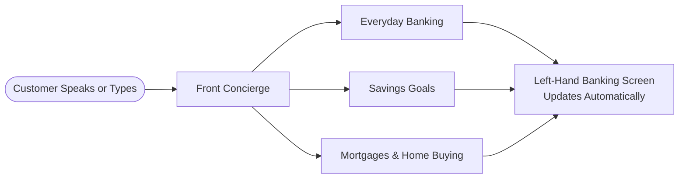

# CX Agent Studio (GECX) for Beginners — A 5-Minute Guide

If you have never worked with [CX Agent Studio](https://docs.cloud.google.com/gemini-enterprise-cx/cx-agent-studio) before, the easiest way to picture Cloudbank is as a **modern high-street bank branch** paired with a **live digital banking screen**.

## 1. One Branch, Four Desks

Imagine walking into a Cloudbank branch:

1. **The Front Concierge Desk:** Greets you by name, opens your account overview or profile settings on screen, and immediately brings the right specialist into the conversation without putting you on hold or making you repeat yourself.
2. **The Everyday Banking Desk:** Looks through your last three months of card spending, spots unusual price jumps (like a subscription that suddenly doubled), checks public UK help pages on how to cancel a subscription, and offers to see what saving that monthly money could achieve.
3. **The Savings Desk:** Reviews your savings pot, interest rate, and monthly contributions, and shows how many months sooner you hit your goal if you add extra each month.
4. **The Mortgages Desk:** Checks your remaining mortgage balance, annual fee-free overpayment allowance, interest saved from overpaying, fixed-rate renewal options, or — if you currently rent — how much you could borrow toward your first home.

To the customer, it feels like **one calm, continuous conversation** in the right-hand **Cloudbank Concierge** panel while the left-hand banking app automatically flips to the matching screen and highlights the exact figures being discussed.

---

## 2. Why the AI Never Guesses Maths

Generative language models are great at understanding natural speech (*"What if I put an extra forty-five pounds a month into my pot?"*) and speaking warmly, **not** at doing mental compound-interest arithmetic.

Cloudbank separates those two jobs cleanly:

| Job | Who Does It | Everyday Analogy |
| :--- | :--- | :--- |
| **Listening & Speaking** | The AI voice model | A friendly, articulate banker who listens to your question and reads the verified answer aloud clearly. |
| **Calculating & Checking Rules** | Deterministic Python calculators | A certified ledger calculator that works in exact pennies, checks fee-free limits, and updates the screen. |
| **Safety & Guardrails** | Immediate safety policies | A branch manager who steps in right away with dedicated support numbers if a customer shares distress or vulnerability. |

Because the language model only speaks numbers returned by the calculator, the figure you **hear** in the concierge voice and the figure you **see** on the Savings or Mortgage screen always match to the penny.

---

## 3. Four Ready-Made Customer Stories to Try

You can switch between four fictional UK customers at the top of the screen at any time:

- **Chloe (Homeowner):** Spots a `£45.00` Netflix plan hike in November, checks how to cancel it, sees that redirecting `£45/mo` reaches her `£10,000` Home Emergency Pot `4 months` sooner (`June 2028`), and compares overpaying her mortgage by `£200/mo` (`£17,849.18` interest saved).
- **David (Remortgager):** Reviews family spending, checks a `£62.00` gym charge, and compares `2-year` (`4.15%`) vs `5-year` (`3.75%`) fixed mortgage renewal payments on his `£148,200` mortgage.
- **Tom (First-Time Buyer, Rents):** Has no mortgage yet — explores his indicative `£189,000` borrowing power alongside his `First Home Deposit` pot (`£14,200` of `£35,000` at `4.75% AER`), and sees what redirecting a `£199/mo` software subscription saves.
- **Sarah (Pre-Retirement):** Tests the `10%` annual fee-free mortgage overpayment boundary (`£3,650` remaining this year on her `£96,500` mortgage at `4.05%`) — seeing both an overpayment that triggers an Early Repayment Charge warning (`£400/mo`) and one that lands right on the fee-free limit (`£250/mo + £650` lump sum).

---

## 4. Where to Go Next

- Walk through Chloe, Sarah, and Tom turn by turn in the [End-to-End Walkthrough](../architecture/end_to_end_walkthrough.md).
- Try the hands-on customer scenarios in the [QA Tester Guide](qa_tester_guide.md).
- Dive into official platform concepts in the [CX Agent Studio Documentation](https://docs.cloud.google.com/gemini-enterprise-cx/cx-agent-studio), [Instructions Guide](https://docs.cloud.google.com/gemini-enterprise-cx/cx-agent-studio/instruction), and [Callbacks Guide](https://docs.cloud.google.com/gemini-enterprise-cx/cx-agent-studio/callback).
