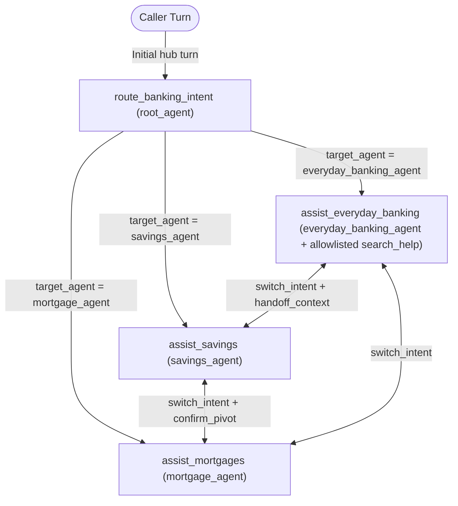

# Python Controller Specifications

Every agent in Cloudbank exposes one deterministic Python controller tool. Controllers own all `customer_snapshot` normalisation, exact integer-pence and basis-point math, monotonic `ui_view_state` screen updates, 2-strike unclear recovery, and silent cross-agent routing via `context.state["target_agent"]`. Shared pure helpers (`_parse_demo_date`, `_emit_ui_view`, `_format_gbp`, `_format_bps`, `_half_up`, `_to_pence`, `_capabilities_message`, `_farewell_response`, `_shared_navigation_response`, `_increment_unclear`, `_unclear_reset_home_response`) live in `cloudbank/cxas_shared/controller_common.py` and are spliced byte-identically into all four controllers by `cloudbank/scripts/sync_shared.py`.

## Controller Progression Across a Multi-Product Session

## Controller Specification Index

| Controller Tool | Owning Agent | Specification | Implementation Source |
| :--- | :--- | :--- | :--- |
| **`route_banking_intent`** | `root_agent` | [route_banking_intent.md](route_banking_intent.md) | [python_code.py](../../cloudbank/cxas_app/Cloudbank/tools/route_banking_intent/python_function/python_code.py) |
| **`assist_everyday_banking`** | `everyday_banking_agent` | [assist_everyday_banking.md](assist_everyday_banking.md) | [python_code.py](../../cloudbank/cxas_app/Cloudbank/tools/assist_everyday_banking/python_function/python_code.py) |
| **`assist_savings`** | `savings_agent` | [assist_savings.md](assist_savings.md) | [python_code.py](../../cloudbank/cxas_app/Cloudbank/tools/assist_savings/python_function/python_code.py) |
| **`assist_mortgages`** | `mortgage_agent` | [assist_mortgages.md](assist_mortgages.md) | [python_code.py](../../cloudbank/cxas_app/Cloudbank/tools/assist_mortgages/python_function/python_code.py) |

### Supporting Wrapped Grounding Tool

- **`search_help`** ([search_help.json](../../cloudbank/cxas_app/Cloudbank/tools/search_help/search_help.json), deterministic fake at [python_code.py](../../cloudbank/cxas_app/Cloudbank/tools/search_help/tool_fake_config/code_block/python_code.py)): `googleSearchTool` hidden from direct LLM calls in `capture_utterance` and invoked exclusively inside [`assist_everyday_banking`](assist_everyday_banking.md) when `query_type == "cancel_subscription"` matches a canonical subscription merchant in `snapshot["transactions"]`, enforcing the exact `https://` official help-host allowlist in `cloudbank/shared/official_help_hosts.json`. `search_help.json` retains `"enableFakeMode": true` (`ToolFakeConfig`) because CX Agent Studio (`GECX`) requires per-tool `enableFakeMode` opt-in for `EvaluationToolCallBehaviour.FAKE` to intercept `tools.search_help` deterministically during NAIVE golden runs, while live `BidiRunSession` traffic executes real Google Search.
