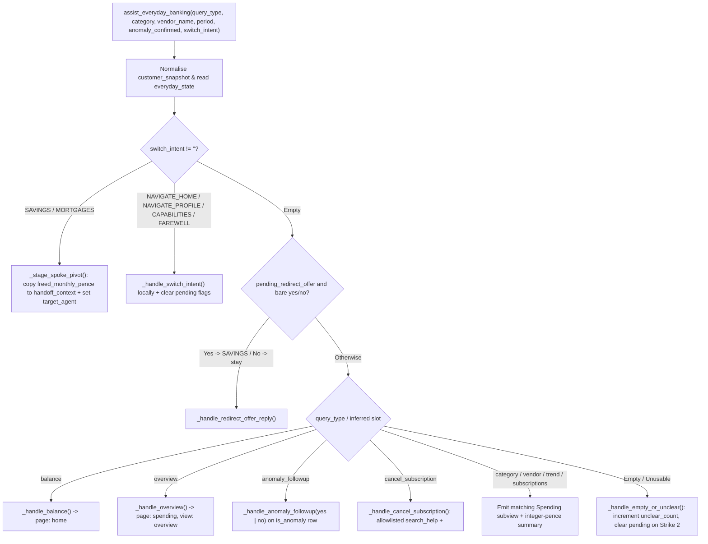

# `assist_everyday_banking` Specification

- **Owning Agent:** `everyday_banking_agent`
- **Implementation:** [python_code.py](../../cloudbank/cxas_app/Cloudbank/tools/assist_everyday_banking/python_function/python_code.py) (thin entrypoint `assist_everyday_banking` delegating to `_dispatch_everyday`)
- **Manifest:** [assist_everyday_banking.json](../../cloudbank/cxas_app/Cloudbank/tools/assist_everyday_banking/assist_everyday_banking.json) (wraps [search_help.json](../../cloudbank/cxas_app/Cloudbank/tools/search_help/search_help.json))

## 1. Overview & Architectural Principles

`assist_everyday_banking` owns current account balances, 3-month statement overviews, category and vendor drilldowns, recurring subscription audits, flagged anomaly confirmations (`yes`/`no`), allowlisted UK subscription cancellation lookups via wrapped `tools.search_help`, and cross-product pivots carrying freed monthly subscription funds into Savings or Mortgages.

Core invariants:
- Exact integer-pence aggregation: normalises `protobuf.Struct` floats once via `_normalize_snapshot` and sums transactions strictly in integer pence across `month_offset` `0`, `1`, and `2` (using UK `"totalling"` in spoken summaries).
- Unicode whole-token vendor matching: matches canonical merchants in `snapshot["transactions"]` by exact normalised form (`_vendors_equal`) or whole-token sequence (`_contains_token_sequence`), so `"Costa"` matches `"Costa Coffee"` while `"EE"` never false-matches `"Coffee"`.
- Per-vendor anomaly & hardened `"no"` recognition handling: stores recognition outcomes per merchant in `everyday_state["anomaly_by_vendor"]` (`"confirmed"` or `"unrecognised"`) strictly on `is_anomaly` rows and emits `anomaly_by_vendor` inside `ui_view_state` so UI badges scope strictly per merchant. When `anomaly_confirmed == "no"` arrives on `anomaly_followup`, alongside `cancel_subscription` (*"I don't recognise that, how do I cancel it?"* in `_record_cancellation_state`), or deferred alongside `balance` / `overview` / `category` / `vendor` / `trend` / `subscriptions`, the charge is marked `"unrecognised"` with card-freeze guidance, `pending_anomaly_vendor` and `last_discussed_subscription` are cleared, and disputed charges are never marked `"confirmed"` or offered as freed savings. Re-ask prompts (`"Just to check..."`) also set `pending_anomaly_vendor`.
- Exact official-host allowlisted `tools.search_help`: invokes `tools.search_help` (`"enableFakeMode": true` for `EvaluationToolCallBehaviour.FAKE` in NAIVE goldens; live Google Search in `BidiRunSession`) only for canonical recurring/subscription merchants present in `snapshot["transactions"]`, validates `urlsplit(url)` strictly for `https://` and an exact hostname match in `cloudbank/shared/official_help_hosts.json` (plus `/gp/help` or `/hz/contact-us` path prefixes on `www.amazon.co.uk`, rejecting user-content subdomains such as `community.*` or `forum.*` and falling back to deterministic steps otherwise), strips Unicode-dash/separator-punctuated 5+ digit phone runs, `tel:`/`phone:`/`call:` prefixes, `(at)` emails, and general `label.tld` domains via `_sanitize_diagnosis_text`, and wraps snippet text in `<untrusted_web_snippet>...</untrusted_web_snippet>` inside `[Diagnosis context: ...]` (stripped by `release_line` and `relay.py`).

## 2. Complete Workflow Flowchart



## 3. Tool Signature & Parameters

```python
def assist_everyday_banking(
    query_type: Literal[
        "",
        "balance",
        "overview",
        "category",
        "vendor",
        "trend",
        "subscriptions",
        "anomaly_followup",
        "cancel_subscription",
    ] = "",
    category: Literal[
        "",
        "groceries",
        "coffee_shops",
        "eating_out",
        "subscriptions",
        "transport",
        "shopping",
        "bills",
        "entertainment",
    ] = "",
    vendor_name: str = "",
    period: Literal["", "this_month", "last_month", "two_months_ago"] = "",
    anomaly_confirmed: Literal["", "yes", "no"] = "",
    switch_intent: Literal[
        "",
        "SAVINGS",
        "MORTGAGES",
        "NAVIGATE_HOME",
        "NAVIGATE_PROFILE",
        "CAPABILITIES",
        "FAREWELL",
    ] = "",
) -> dict:
```

| Parameter | Type | Required | Description |
| :--- | :--- | :--- | :--- |
| `query_type` | `Literal[...]` | No (default `""`) | Everyday banking action (`"balance"`, `"overview"`, `"category"`, `"vendor"`, `"trend"`, `"subscriptions"`, `"anomaly_followup"`, or `"cancel_subscription"`). |
| `category` | `Literal[...]` | No (default `""`) | Spending category for category drilldowns (`"groceries"`, `"coffee_shops"`, `"eating_out"`, `"subscriptions"`, `"transport"`, `"shopping"`, `"bills"`, `"entertainment"`). |
| `vendor_name` | `str` | No (default `""`) | Merchant or subscription provider spoken by the caller (resolved against `snapshot["transactions"]`). |
| `period` | `Literal[...]` | No (default `""`) | Statement month scope (`"this_month"`, `"last_month"`, or `"two_months_ago"`). |
| `anomaly_confirmed` | `Literal["", "yes", "no"]` | No (default `""`) | `"yes"` when confirming a flagged charge (or accepting a pending savings redirect offer), `"no"` when disputing or declining. |
| `switch_intent` | `Literal[...]` | No (default `""`) | Cross-product pivot or local navigation (`"SAVINGS"`, `"MORTGAGES"`, `"NAVIGATE_HOME"`, `"NAVIGATE_PROFILE"`, `"CAPABILITIES"`, `"FAREWELL"`). |

## 4. Sub-Flow Details & Session State Reads/Writes

### Helper Index ([python_code.py](../../cloudbank/cxas_app/Cloudbank/tools/assist_everyday_banking/python_function/python_code.py))

- `_normalize_snapshot`, `_parse_demo_date`, `_month_name_for_offset()`, `_format_gbp`, `_format_bps`, and `_emit_ui_view`: coerce `protobuf.Struct` numbers to `int`, validate `demo_date` via `datetime.date` (spliced from `controller_common.py`), format currency and rates, and increment `ui_view_state.seq` (attaching per-merchant `anomaly_by_vendor`).
- `_normalize_vendor_forms`, `_contains_token_sequence`, `_vendors_equal`, and `_match_vendor_rows`: Unicode exact and whole-token vendor matching across customer transactions.
- `_handle_switch_intent`, `_stage_spoke_pivot()`, and `_handle_redirect_offer_reply()`: spoke-local navigation with pending-flag and `handoff_context` cleanup, `pass_count > 4` loop guard, and `handoff_context` staging.
- `_handle_balance()`, `_month_delta_clause()`, `_overview_with_anomaly()`, and `_handle_overview()`: current account balance, monthly spend totals, month-on-month delta, and unconfirmed anomaly prompt.
- `_mark_anomaly_unrecognised()`, `_handle_anomaly_followup()`, `_resolve_cancellation_target()`, `_record_cancellation_state`, `_sanitize_diagnosis_text`, `_unwrap_search_response`, `_lookup_cancellation_guidance`, and `_handle_cancel_subscription()`: per-vendor `anomaly_by_vendor` tracking (including `"no"` alongside cancellation or deferred queries) and exact `https://` official-host allowlisted `tools.search_help` wrapping with hardened contact-detail stripping and `<untrusted_web_snippet>` delimiters.
- `_handle_category()`, `_handle_vendor()`, `_format_trend_direction()`, `_handle_trend()`, `_handle_subscriptions()`, and `_handle_empty_or_unclear()`: per-view aggregations and bounded 2-strike unclear recovery.

### Session State Reads & Writes

| Variable | Direction | Purpose |
| :--- | :--- | :--- |
| `customer_snapshot` | Read | Reads `accounts.current` (`current`), `accounts.savings` (`savings`), and `transactions`. |
| `demo_date` / `first_name` | Read | Anchors calendar month names and personalises farewells. |
| `pass_count` | Read | Bounds cross-spoke pivots (`int(pass_count) > 4` stops ping-pong loops). |
| `handoff_context` | Write | Populated with `{from_agent, vendor, freed_monthly_pence}` when pivoting to `SAVINGS` or `MORTGAGES` (cleared on `NAVIGATE_HOME` / `NAVIGATE_PROFILE`). |
| `everyday_state` | Read / Write | Tracks `pending_anomaly_vendor`, `anomaly_by_vendor`, `pending_redirect_offer`, and `last_discussed_subscription`. |
| `ui_view_state` | Read / Write | Emits `home`, `profile`, or `spending` (`overview`, `category`, `vendor`, `trend`, `subscriptions`) with canonical `highlight_vendor`, `anomaly_status`, and per-merchant `anomaly_by_vendor`. |
| `target_agent` | Write | Stages `savings_agent` or `mortgage_agent` on cross-spoke pivots. |
| `unclear_count` | Read / Write | Resets to `"0"` on valid queries; increments across pending/unmatched turns and clears pending flags on Strike 2. |
| `call_complete` / `escalation_reason` | Write | Set on `switch_intent="FAREWELL"`. |
