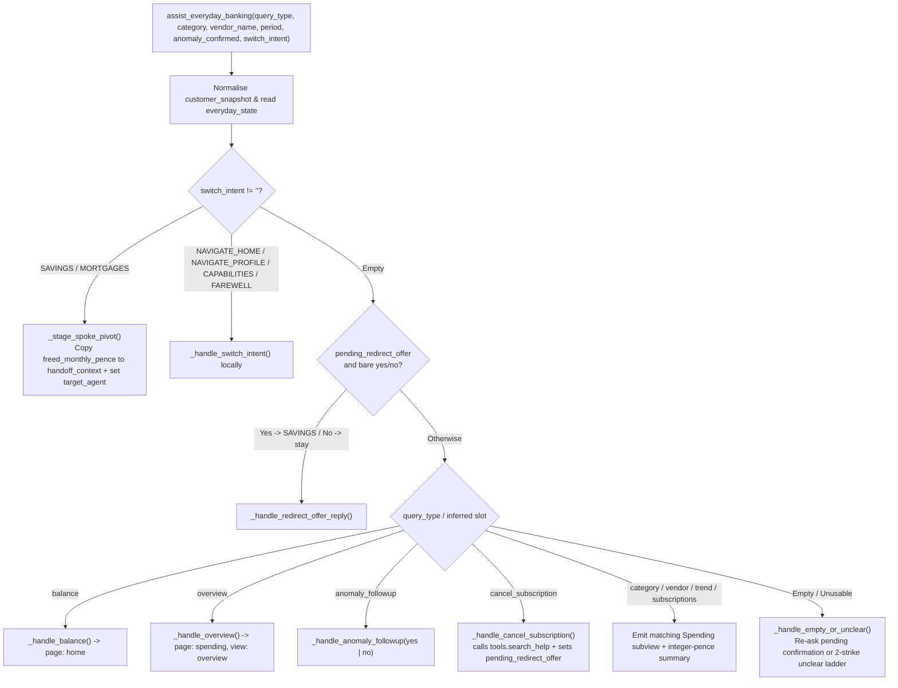

# `assist_everyday_banking` Specification

- **Owning Agent:** `everyday_banking_agent`
- **Implementation:** [python_code.py](../../cloudbank/cxas_app/Cloudbank/tools/assist_everyday_banking/python_function/python_code.py#L1-L1015) (entrypoint at [`#L45-L192`](../../cloudbank/cxas_app/Cloudbank/tools/assist_everyday_banking/python_function/python_code.py#L45-L192))
- **Manifest:** [assist_everyday_banking.json](../../cloudbank/cxas_app/Cloudbank/tools/assist_everyday_banking/assist_everyday_banking.json) (wraps [search_help.json](../../cloudbank/cxas_app/Cloudbank/tools/search_help/search_help.json))

## 1. Overview & Architectural Principles

`assist_everyday_banking` owns current account balances, 3-month statement overviews, category and vendor drilldowns, recurring subscription audits, flagged anomaly confirmations (`yes`/`no`), UK subscription cancellation lookups via wrapped `tools.search_help`, and cross-product pivots carrying freed monthly subscription funds into Savings or Mortgages.

Core invariants:
- **Exact integer-pence aggregation:** Normalises `protobuf.Struct` floats once via `_normalize_snapshot` and sums transactions strictly in integer pence across `month_offset` `0`, `1`, and `2`.
- **Whole-token vendor matching (`S2-1`):** Matches vendors by exact normalised form or whole-token sequence (so `"Costa"` matches `"Costa Coffee"`, while `"EE"` never false-matches `"Coffee"`).
- **Anomaly & disputed-money safety (`S2-2`..`S2-4`):** Persists resolved `anomaly_status` (`"confirmed"` or `"unrecognised"`), never marks household `bills` as cancellable discretionary subscriptions, and clears `last_discussed_subscription` when a charge is marked `"unrecognised"` so disputed charges are never handed off as freed savings.
- **Wrapped `tools.search_help` (`Design 6A`):** Invokes `tools.search_help` inside Python on `cancel_subscription`, appending `[Diagnosis context: ...]` (stripped by `release_line`) and setting `pending_redirect_offer = True` so a bare `"yes"` on the next turn pivots cleanly to `savings_agent`.

## 2. Complete Workflow Flowchart



## 3. Tool Signature & Parameters

```python
def assist_everyday_banking(
    query_type: Literal[
        "",
        "balance",
        "overview",
        "category",
        "vendor",
        "trend",
        "subscriptions",
        "anomaly_followup",
        "cancel_subscription",
    ] = "",
    category: Literal[
        "",
        "groceries",
        "coffee_shops",
        "eating_out",
        "subscriptions",
        "transport",
        "shopping",
        "bills",
        "entertainment",
    ] = "",
    vendor_name: str = "",
    period: Literal["", "this_month", "last_month", "two_months_ago"] = "",
    anomaly_confirmed: Literal["", "yes", "no"] = "",
    switch_intent: Literal[
        "",
        "SAVINGS",
        "MORTGAGES",
        "NAVIGATE_HOME",
        "NAVIGATE_PROFILE",
        "CAPABILITIES",
        "FAREWELL",
    ] = "",
) -> dict:
```

| Parameter | Type | Required | Description |
| :--- | :--- | :--- | :--- |
| `query_type` | `Literal[...]` | No (default `""`) | Everyday banking action (`"balance"`, `"overview"`, `"category"`, `"vendor"`, `"trend"`, `"subscriptions"`, `"anomaly_followup"`, or `"cancel_subscription"`). |
| `category` | `Literal[...]` | No (default `""`) | Spending category for category drilldowns (`"groceries"`, `"coffee_shops"`, `"eating_out"`, `"subscriptions"`, `"transport"`, `"shopping"`, `"bills"`, `"entertainment"`). |
| `vendor_name` | `str` | No (default `""`) | Merchant or subscription provider spoken by the caller. |
| `period` | `Literal[...]` | No (default `""`) | Statement month scope (`"this_month"`, `"last_month"`, or `"two_months_ago"`). |
| `anomaly_confirmed` | `Literal["", "yes", "no"]` | No (default `""`) | `"yes"` when confirming a flagged charge (or accepting a pending savings redirect offer), `"no"` when disputing/declining. |
| `switch_intent` | `Literal[...]` | No (default `""`) | Cross-product pivot or local navigation (`"SAVINGS"`, `"MORTGAGES"`, `"NAVIGATE_HOME"`, `"NAVIGATE_PROFILE"`, `"CAPABILITIES"`, `"FAREWELL"`). |

## 4. Sub-Flow Details & Session State Reads/Writes

### Helper Index

- [`_normalize_snapshot`](../../cloudbank/cxas_app/Cloudbank/tools/assist_everyday_banking/python_function/python_code.py#L195-L232) & [`_parse_demo_date` / formatting / `_emit_ui_view`](../../cloudbank/cxas_app/Cloudbank/tools/assist_everyday_banking/python_function/python_code.py#L235-L277): Coerce `protobuf.Struct` numbers to `int`, resolve `demo_date` calendar month names, format pounds/AER, and increment `ui_view_state.seq`.
- [`_normalize_vendor_forms` .. `_match_vendor_rows`](../../cloudbank/cxas_app/Cloudbank/tools/assist_everyday_banking/python_function/python_code.py#L280-L339): Exact and whole-token vendor matching across customer transactions.
- [`_handle_switch_intent` / `_stage_spoke_pivot` / `_handle_redirect_offer_reply`](../../cloudbank/cxas_app/Cloudbank/tools/assist_everyday_banking/python_function/python_code.py#L342-L428): Local `Home`/`Profile`/`Capabilities`/`Farewell` handling, cross-spoke loop guard (`S2-5`), and `handoff_context` staging.
- [`_handle_balance`](../../cloudbank/cxas_app/Cloudbank/tools/assist_everyday_banking/python_function/python_code.py#L431-L449) & [`_handle_overview`](../../cloudbank/cxas_app/Cloudbank/tools/assist_everyday_banking/python_function/python_code.py#L452-L562): Current account balance and monthly spend totals, month-on-month delta, and unconfirmed anomaly prompt.
- [`_handle_anomaly_followup`](../../cloudbank/cxas_app/Cloudbank/tools/assist_everyday_banking/python_function/python_code.py#L565-L653) & [`_handle_cancel_subscription` / `_lookup_cancellation_guidance`](../../cloudbank/cxas_app/Cloudbank/tools/assist_everyday_banking/python_function/python_code.py#L656-L788): Marks recognised vs `"Marked as not recognised"` charges and wraps `tools.search_help` with resilient fallback when empty or unavailable.
- [`_handle_category`](../../cloudbank/cxas_app/Cloudbank/tools/assist_everyday_banking/python_function/python_code.py#L791-L839), [`_handle_vendor`](../../cloudbank/cxas_app/Cloudbank/tools/assist_everyday_banking/python_function/python_code.py#L842-L901), [`_handle_trend`](../../cloudbank/cxas_app/Cloudbank/tools/assist_everyday_banking/python_function/python_code.py#L904-L925), [`_handle_subscriptions`](../../cloudbank/cxas_app/Cloudbank/tools/assist_everyday_banking/python_function/python_code.py#L928-L975), and [`_handle_empty_or_unclear`](../../cloudbank/cxas_app/Cloudbank/tools/assist_everyday_banking/python_function/python_code.py#L978-L1015): Per-view aggregations and pending-question / 2-strike unclear handling.

### Session State Reads & Writes

| Variable | Direction | Purpose |
| :--- | :--- | :--- |
| `customer_snapshot` | Read | Reads `current_account`, `savings` (for balance context), and `transactions`. |
| `demo_date` / `first_name` | Read | Anchors calendar month names and personalises farewells. |
| `handoff_context` | Read / Write | Cleared on entry; populated with `{from_agent, vendor, freed_monthly_pence}` when pivoting to `SAVINGS` or `MORTGAGES`. |
| `everyday_state` | Read / Write | Private state tracking `pending_anomaly_vendor`, `anomaly_status`, `pending_redirect_offer`, `last_discussed_subscription`, `pivot_hop_turn`, and `pivot_hop_count`. |
| `ui_view_state` | Read / Write | Emits `home`, `profile`, or `spending` (`overview`, `category`, `vendor`, `trend`, `subscriptions`) with `highlight_vendor` and `anomaly_status`. |
| `target_agent` | Write | Stages `savings_agent` or `mortgage_agent` on cross-spoke pivots. |
| `unclear_count` | Read / Write | Resets to `"0"` on valid queries; runs 2-strike ladder on unusable calls. |
| `call_complete` / `escalation_reason` | Write | Set on `switch_intent="FAREWELL"`. |
