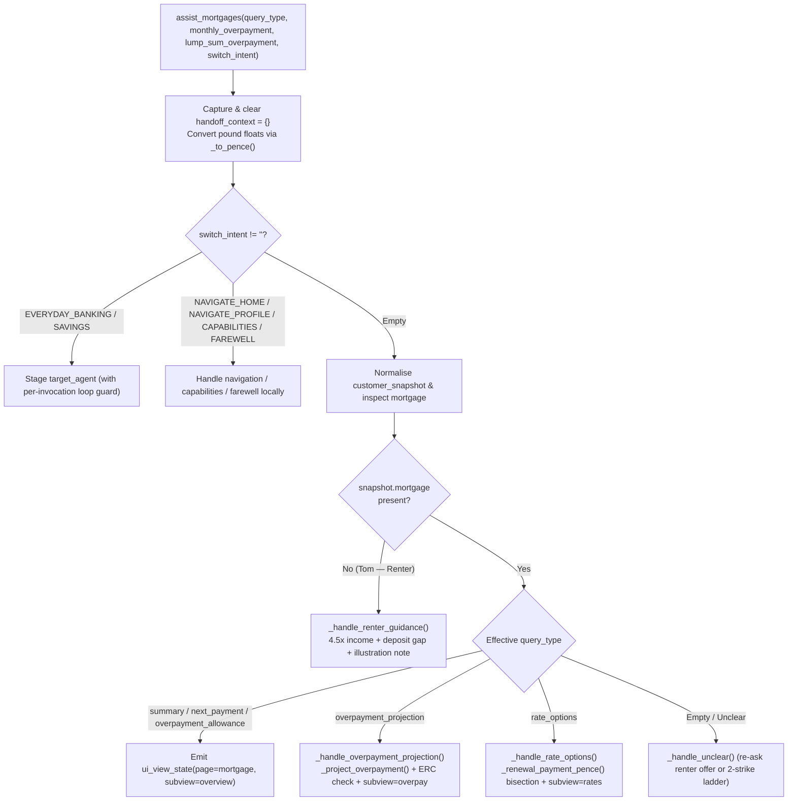

# `assist_mortgages` Specification

- **Owning Agent:** `mortgage_agent`
- **Implementation:** [python_code.py](../../cloudbank/cxas_app/Cloudbank/tools/assist_mortgages/python_function/python_code.py#L1-L628) (entrypoint & thin dispatcher at [`#L29-L134`](../../cloudbank/cxas_app/Cloudbank/tools/assist_mortgages/python_function/python_code.py#L29-L134))
- **Manifest:** [assist_mortgages.json](../../cloudbank/cxas_app/Cloudbank/tools/assist_mortgages/assist_mortgages.json)

## 1. Overview & Architectural Principles

`assist_mortgages` handles mortgage balance and rate summaries, next payment dates, 10% annual ERC-free overpayment allowances, monthly and lump-sum overpayment amortisation projections, fixed-rate renewal comparisons, and first-time buyer borrowing/deposit readiness for renters (`accounts.mortgage` omitted in the fixture, normalised to `snapshot["mortgage"] = None`).

Core invariants:
- **Exact amortisation & integer bisection:** Uses `_simulate_mortgage` (`_half_up(bal * rate_bps, 120_000)` monthly interest, cap `600` months) for overpayment savings and `_renewal_payment_pence` integer bisection over the identical kernel for 2-year and 5-year fixed renewal deals.
- **Year-one ERC allowance accuracy:** Clamps year-one monthly overpayments by `min(12, projected.months)` and checks strict inequality (`first_year > remaining_allowance`) so exact-boundary overpayments remain ERC-free.
- **Mandatory indicative-illustration note:** Appends `"These figures are an indicative illustration only and not personalised mortgage advice."` directly inside `agent_action` on every overpayment, renewal-rate, and renter-borrowing response.
- **Renter readiness (`mortgage is None`):** Computes `4.5×` annual income max borrowing (`_half_up(annual_income_pence * 45, 10)`), deposit progress, and stages `pending_savings_pivot = True` so a follow-up `"yes"` pivots cleanly to `savings_agent`.

## 2. Complete Workflow Flowchart



## 3. Tool Signature & Parameters

```python
def assist_mortgages(
    query_type: Literal[
        "",
        "summary",
        "next_payment",
        "overpayment_allowance",
        "overpayment_projection",
        "rate_options",
    ] = "",
    monthly_overpayment: float = 0.0,
    lump_sum_overpayment: float = 0.0,
    switch_intent: Literal[
        "",
        "EVERYDAY_BANKING",
        "SAVINGS",
        "NAVIGATE_HOME",
        "NAVIGATE_PROFILE",
        "CAPABILITIES",
        "FAREWELL",
    ] = "",
) -> dict:
```

| Parameter | Type | Required | Description |
| :--- | :--- | :--- | :--- |
| `query_type` | `Literal[...]` | No (default `""`) | Specific mortgage request (`"summary"`, `"next_payment"`, `"overpayment_allowance"`, `"overpayment_projection"`, or `"rate_options"`). |
| `monthly_overpayment` | `float` | No (default `0.0`) | Proposed extra monthly overpayment in pounds spoken by the caller, or `0.0` when omitted. |
| `lump_sum_overpayment` | `float` | No (default `0.0`) | Proposed one-off lump-sum overpayment in pounds spoken by the caller, or `0.0` when omitted. |
| `switch_intent` | `Literal[...]` | No (default `""`) | Cross-product pivot or local navigation (`"EVERYDAY_BANKING"`, `"SAVINGS"`, `"NAVIGATE_HOME"`, `"NAVIGATE_PROFILE"`, `"CAPABILITIES"`, `"FAREWELL"`). |

## 4. Sub-Flow Details & Session State Reads/Writes

### Helper Index

- [`_half_up` / `_to_pence`](../../cloudbank/cxas_app/Cloudbank/tools/assist_mortgages/python_function/python_code.py#L137-L148): Exact integer half-up division and clamped model-float-to-pence conversion.
- [`_simulate_mortgage` / `_renewal_payment_pence` / `_project_overpayment`](../../cloudbank/cxas_app/Cloudbank/tools/assist_mortgages/python_function/python_code.py#L151-L242): Month-by-month amortisation loop, integer bisection solver for fixed-rate renewal deals, and ERC-aware overpayment comparator.
- [`_normalize_snapshot` .. `_emit_ui_view`](../../cloudbank/cxas_app/Cloudbank/tools/assist_mortgages/python_function/python_code.py#L245-L368): Snapshot normalisation, `demo_date` & payment-day helpers, duration/currency/rate formatters, and monotonic `ui_view_state` writer.
- [`_handle_summary` / `_handle_next_payment` / `_handle_allowance`](../../cloudbank/cxas_app/Cloudbank/tools/assist_mortgages/python_function/python_code.py#L371-L428): Mortgage balance, current deal rate, next Direct Debit date/amount, and remaining 10% annual fee-free allowance.
- [`_handle_overpayment_projection`](../../cloudbank/cxas_app/Cloudbank/tools/assist_mortgages/python_function/python_code.py#L431-L498), [`_handle_rate_options`](../../cloudbank/cxas_app/Cloudbank/tools/assist_mortgages/python_function/python_code.py#L501-L528), and [`_handle_renter_guidance`](../../cloudbank/cxas_app/Cloudbank/tools/assist_mortgages/python_function/python_code.py#L531-L553): Overpayment projection, 2-year vs 5-year fixed renewal comparison, and first-time buyer readiness.
- [`_handle_switch_intent`](../../cloudbank/cxas_app/Cloudbank/tools/assist_mortgages/python_function/python_code.py#L556-L603) & [`_handle_unclear`](../../cloudbank/cxas_app/Cloudbank/tools/assist_mortgages/python_function/python_code.py#L606-L628): Local navigation, guarded cross-spoke pivots, and 2-strike unclear recovery.

### Session State Reads & Writes

| Variable | Direction | Purpose |
| :--- | :--- | :--- |
| `customer_snapshot` | Read | Reads `mortgage` (when homeowner) or `user.annual_income_pence` + `savings` (when renter). |
| `handoff_context` | Read / Write | Consumes optional `freed_monthly_pence` for default monthly overpayment and clears to `{}` on entry. |
| `demo_date` / `first_name` | Read | Resolves next monthly payment date and personalises farewells. |
| `pass_count` | Read | Bounds cross-spoke pivots (`int(pass_count) > 4` stops ping-pong loops). |
| `mortgage_state` | Read / Write | Tracks `last_subview`, `monthly_overpayment_pence`, `lump_sum_overpayment_pence`, and `pending_savings_pivot`. |
| `ui_view_state` | Read / Write | Emits `{page: "mortgage", subview, monthly_overpayment_pence?, lump_sum_overpayment_pence?}` (or `home`/`profile`). |
| `target_agent` | Write | Stages `everyday_banking_agent` or `savings_agent` on cross-spoke pivots. |
| `unclear_count` | Read / Write | Shared 2-strike non-terminating unclear counter. |
| `call_complete` / `escalation_reason` | Write | Set on `switch_intent="FAREWELL"`. |
