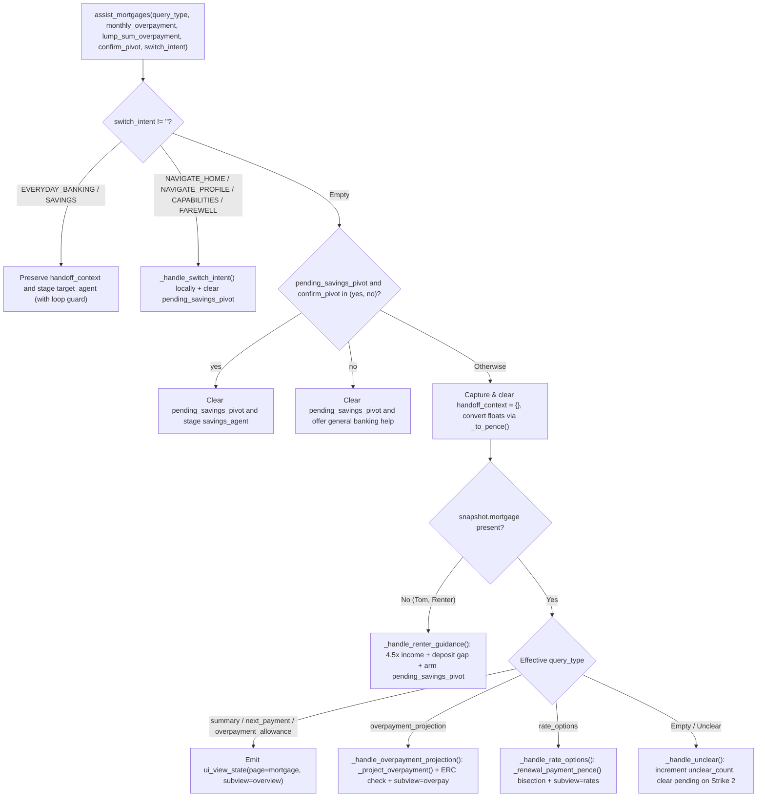

# `assist_mortgages` Specification

- **Owning Agent:** `mortgage_agent`
- **Implementation:** [python_code.py](../../cloudbank/cxas_app/Cloudbank/tools/assist_mortgages/python_function/python_code.py) (thin entrypoint `assist_mortgages` delegating to `_dispatch_mortgage`)
- **Manifest:** [assist_mortgages.json](../../cloudbank/cxas_app/Cloudbank/tools/assist_mortgages/assist_mortgages.json)

## 1. Overview & Architectural Principles

`assist_mortgages` handles mortgage balance and rate summaries, next payment dates, 10% annual ERC-free overpayment allowances, monthly and lump-sum overpayment amortisation projections, fixed-rate renewal comparisons, and first-time buyer borrowing and deposit readiness for renters (`accounts.mortgage` omitted in the fixture, normalised to `snapshot["mortgage"] = None`).

Core invariants:
- Exact amortisation, zero-balance & negative-amortisation guards: uses `_simulate_mortgage` (`_half_up(bal * rate_bps, 120_000)` monthly interest, cap `600` months, exiting the monthly loop immediately when `interest >= payment`) and `_renewal_payment_pence` integer bisection (`0` when `balance_pence <= 0`) for 2-year and 5-year fixed renewal deals, matching `cloudbank/web/src/util/mortgageMath.ts` (`BigInt` `halfUp`).
- Year-one ERC allowance accuracy: clamps year-one monthly overpayments by `min(12, projected.months)` and checks strict inequality (`first_year > remaining_allowance`) so exact-boundary overpayments remain ERC-free.
- Mandatory indicative-illustration note: appends `"These figures are an indicative illustration only and not personalised mortgage advice."` directly inside `agent_action` on every overpayment, renewal-rate, and renter-borrowing response.
- Renter readiness & `confirm_pivot`: when `mortgage is None`, computes `4.5×` annual income max borrowing (`_half_up(annual_income_pence * 45, 10)`), deposit progress, and sets `pending_savings_pivot = True`. When `pending_savings_pivot` is `True`, a follow-up `confirm_pivot="yes"` (or `switch_intent="SAVINGS"`) pivots to `savings_agent`, `confirm_pivot="no"` clears `pending_savings_pivot = False` cleanly without re-asking, and unmatched turns increment `unclear_count` (clearing `pending_savings_pivot = False` on Strike 2).

## 2. Complete Workflow Flowchart



## 3. Tool Signature & Parameters

```python
def assist_mortgages(
    query_type: Literal[
        "",
        "summary",
        "next_payment",
        "overpayment_allowance",
        "overpayment_projection",
        "rate_options",
    ] = "",
    monthly_overpayment: float = 0.0,
    lump_sum_overpayment: float = 0.0,
    confirm_pivot: Literal["", "yes", "no"] = "",
    switch_intent: Literal[
        "",
        "EVERYDAY_BANKING",
        "SAVINGS",
        "NAVIGATE_HOME",
        "NAVIGATE_PROFILE",
        "CAPABILITIES",
        "FAREWELL",
    ] = "",
) -> dict:
```

| Parameter | Type | Required | Description |
| :--- | :--- | :--- | :--- |
| `query_type` | `Literal[...]` | No (default `""`) | Specific mortgage request (`"summary"`, `"next_payment"`, `"overpayment_allowance"`, `"overpayment_projection"`, or `"rate_options"`). |
| `monthly_overpayment` | `float` | No (default `0.0`) | Proposed extra monthly overpayment in pounds spoken by the caller, or `0.0` when omitted. |
| `lump_sum_overpayment` | `float` | No (default `0.0`) | Proposed one-off lump-sum overpayment in pounds spoken by the caller, or `0.0` when omitted. |
| `confirm_pivot` | `Literal["", "yes", "no"]` | No (default `""`) | `"yes"` to accept the First Home Deposit savings projection offer for renters, `"no"` to decline cleanly, or `""` otherwise. |
| `switch_intent` | `Literal[...]` | No (default `""`) | Cross-product pivot or local navigation (`"EVERYDAY_BANKING"`, `"SAVINGS"`, `"NAVIGATE_HOME"`, `"NAVIGATE_PROFILE"`, `"CAPABILITIES"`, `"FAREWELL"`). |

## 4. Sub-Flow Details & Session State Reads/Writes

### Helper Index ([python_code.py](../../cloudbank/cxas_app/Cloudbank/tools/assist_mortgages/python_function/python_code.py))

- `_half_up` and `_to_pence`: exact integer half-up division and clamped model-float-to-pence conversion, spliced from `controller_common.py`.
- `_simulate_mortgage`, `_renewal_payment_pence`, and `_project_overpayment`: month-by-month amortisation loop (with early exit when `interest >= payment`), zero-balance-safe integer bisection solver for fixed-rate renewal deals, and ERC-aware overpayment comparator.
- `_normalize_snapshot`, `_parse_demo_date`, `_format_gbp`, `_format_bps`, `_format_months_duration()`, `_next_payment_label()`, `_format_iso_month_year()`, and `_emit_ui_view`: snapshot normalisation, `datetime.date` validation and month-length clamping, duration/currency/rate formatters, and monotonic `ui_view_state` writer.
- `_handle_summary()`, `_handle_next_payment()`, and `_handle_allowance()`: mortgage balance, current deal rate, next Direct Debit date/amount, and remaining 10% annual fee-free allowance.
- `_format_overpayment_reply()`, `_handle_overpayment_projection()`, `_handle_rate_options()`, and `_handle_renter_guidance`: overpayment projection, 2-year vs 5-year fixed renewal comparison, and first-time buyer readiness.
- `_handle_switch_intent` and `_handle_unclear()`: spoke-local navigation with pending-flag cleanup, guarded cross-spoke pivots, and bounded 2-strike unclear recovery.

### Session State Reads & Writes

| Variable | Direction | Purpose |
| :--- | :--- | :--- |
| `customer_snapshot` | Read | Reads `mortgage` (when homeowner) or `user.annual_income_pence` + `savings` (when renter). |
| `handoff_context` | Read / Write | Preserved across `switch_intent` hops; consumed for default monthly overpayment and cleared to `{}` on local turns. |
| `demo_date` / `first_name` | Read | Resolves clamped next monthly payment date and personalises farewells. |
| `pass_count` | Read | Bounds cross-spoke pivots (`int(pass_count) > 4` stops ping-pong loops). |
| `mortgage_state` | Read / Write | Tracks `pending_savings_pivot` for renter deposit-timeline follow-up turns. |
| `ui_view_state` | Read / Write | Emits `{page: "mortgage", subview, monthly_overpayment_pence?, lump_sum_overpayment_pence?}` (or `home`/`profile`). |
| `target_agent` | Write | Stages `everyday_banking_agent` or `savings_agent` on cross-spoke pivots. |
| `unclear_count` | Read / Write | Shared 2-strike non-terminating unclear counter (incremented on unmatched pending turns as well). |
| `call_complete` / `escalation_reason` | Write | Set on `switch_intent="FAREWELL"`. |
