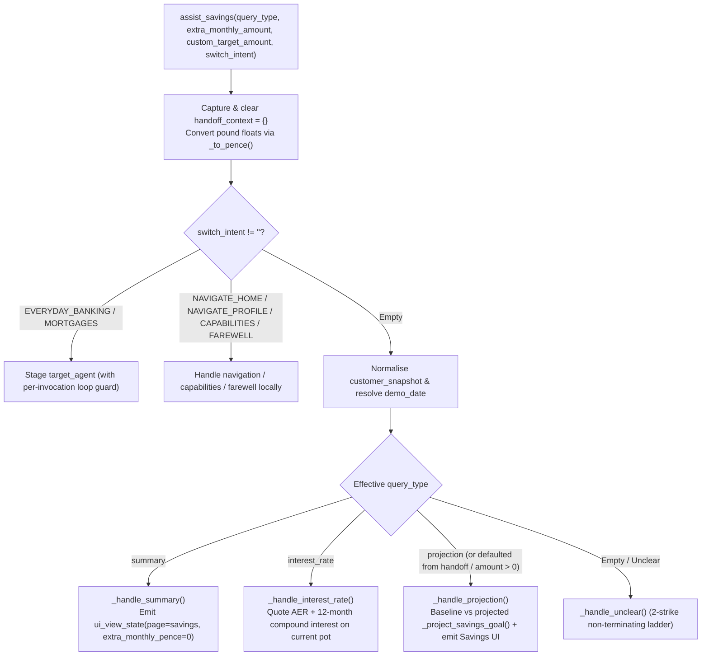

# `assist_savings` Specification

- **Owning Agent:** `savings_agent`
- **Implementation:** [python_code.py](../../cloudbank/cxas_app/Cloudbank/tools/assist_savings/python_function/python_code.py#L1-L478) (entrypoint at [`#L26-L123`](../../cloudbank/cxas_app/Cloudbank/tools/assist_savings/python_function/python_code.py#L26-L123))
- **Manifest:** [assist_savings.json](../../cloudbank/cxas_app/Cloudbank/tools/assist_savings/assist_savings.json)

## 1. Overview & Architectural Principles

`assist_savings` owns savings pot summaries, AER vs gross contractual interest rate inquiries, and month-by-month compound goal completion projections.

Core invariants:
- **One-shot `handoff_context` consumption:** Reads `context.state["handoff_context"]` on entry and immediately resets `context.state["handoff_context"] = {}`. When `query_type in ("", "projection")` and `extra_monthly_amount <= 0`, automatically applies `freed_monthly_pence` from a subscription discussed in Everyday Banking (attributing the vendor name in `agent_action`).
- **Exact integer compounding (`gross_rate_bps` vs `aer_bps`):** Simulates up to `600` months using `_half_up(pot * gross_rate_bps, 120_000)` per month while quoting `aer_bps` in speech, matching `cloudbank/web/src/util/savingsMath.ts` and `cloudbank/shared/parity_vectors.json` penny-for-penny.

## 2. Complete Workflow Flowchart



## 3. Tool Signature & Parameters

```python
def assist_savings(
    query_type: Literal["", "summary", "projection", "interest_rate"] = "",
    extra_monthly_amount: float = 0.0,
    custom_target_amount: float = 0.0,
    switch_intent: Literal[
        "",
        "EVERYDAY_BANKING",
        "MORTGAGES",
        "NAVIGATE_HOME",
        "NAVIGATE_PROFILE",
        "CAPABILITIES",
        "FAREWELL",
    ] = "",
) -> dict:
```

| Parameter | Type | Required | Description |
| :--- | :--- | :--- | :--- |
| `query_type` | `Literal["", "summary", "projection", "interest_rate"]` | No (default `""`) | Savings question type (`"summary"`, `"projection"`, or `"interest_rate"`). |
| `extra_monthly_amount` | `float` | No (default `0.0`) | Additional monthly savings contribution in pounds spoken by the caller, or `0.0` when omitted. |
| `custom_target_amount` | `float` | No (default `0.0`) | Custom savings goal target in pounds spoken by the caller, or `0.0` to use the existing pot target. |
| `switch_intent` | `Literal[...]` | No (default `""`) | Cross-product pivot or local navigation (`"EVERYDAY_BANKING"`, `"MORTGAGES"`, `"NAVIGATE_HOME"`, `"NAVIGATE_PROFILE"`, `"CAPABILITIES"`, `"FAREWELL"`). |

## 4. Sub-Flow Details & Session State Reads/Writes

### Helper Index

- [`_half_up` / `_to_pence`](../../cloudbank/cxas_app/Cloudbank/tools/assist_savings/python_function/python_code.py#L126-L137): Exact integer half-up division and clamped model-float-to-pence conversion (`[0, £10,000,000]`).
- [`_project_savings_goal` / `_annual_interest_on_balance` / `_target_month_label`](../../cloudbank/cxas_app/Cloudbank/tools/assist_savings/python_function/python_code.py#L140-L195): 600-month compound goal simulator, 12-step annual interest on current balance, and calendar completion month formatter.
- [`_normalize_snapshot` .. `_emit_ui_view`](../../cloudbank/cxas_app/Cloudbank/tools/assist_savings/python_function/python_code.py#L198-L255): Snapshot integer coercion, `demo_date` parser, currency/rate formatters, and monotonic `ui_view_state` writer.
- [`_handle_summary`](../../cloudbank/cxas_app/Cloudbank/tools/assist_savings/python_function/python_code.py#L258-L300), [`_handle_interest_rate`](../../cloudbank/cxas_app/Cloudbank/tools/assist_savings/python_function/python_code.py#L303-L317), and [`_handle_projection`](../../cloudbank/cxas_app/Cloudbank/tools/assist_savings/python_function/python_code.py#L320-L399): Savings pot balance/AER summary, rate details, and goal completion timeline delta.
- [`_handle_switch_intent`](../../cloudbank/cxas_app/Cloudbank/tools/assist_savings/python_function/python_code.py#L402-L459) & [`_handle_unclear`](../../cloudbank/cxas_app/Cloudbank/tools/assist_savings/python_function/python_code.py#L462-L478): Spoke-local navigation, guarded cross-spoke pivots, and 2-strike unclear recovery.

### Session State Reads & Writes

| Variable | Direction | Purpose |
| :--- | :--- | :--- |
| `customer_snapshot` | Read | Reads `savings` (`name`, `balance_pence`, `gross_rate_bps`, `aer_bps`, `monthly_contribution_pence`, `goal_target_pence`). |
| `handoff_context` | Read / Write | Reads optional `{vendor, freed_monthly_pence}` and clears to `{}` on entry. |
| `demo_date` / `first_name` | Read | Computes completion month/year from statement date and personalises farewells. |
| `pass_count` | Read | Bounds cross-spoke pivots (`int(pass_count) > 4` stops ping-pong loops). |
| `savings_state` | Read / Write | Tracks `last_extra_monthly_pence` and `last_custom_target_pence`. |
| `ui_view_state` | Read / Write | Emits `{page: "savings", extra_monthly_pence, custom_target_pence?}` (or `home`/`profile`). |
| `target_agent` | Write | Stages `everyday_banking_agent` or `mortgage_agent` on cross-spoke pivots. |
| `unclear_count` | Read / Write | Shared 2-strike non-terminating unclear counter. |
| `call_complete` / `escalation_reason` | Write | Set on `switch_intent="FAREWELL"`. |
