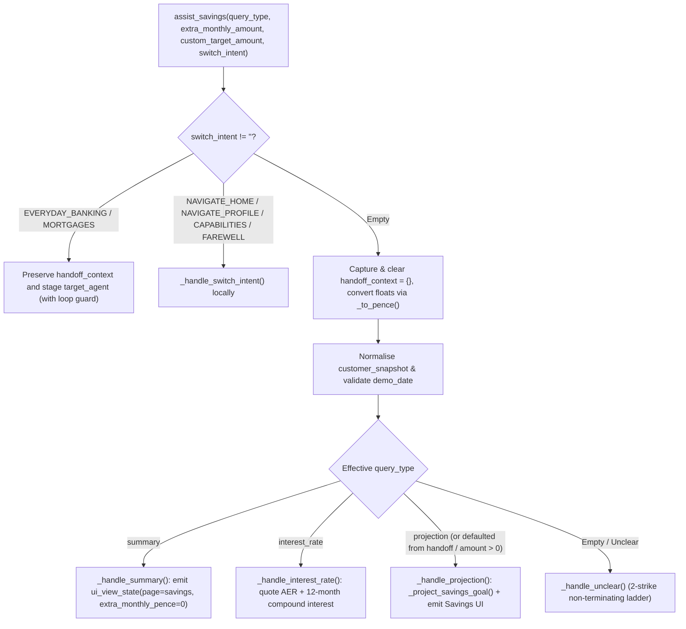

# `assist_savings` Specification

- **Owning Agent:** `savings_agent`
- **Implementation:** [python_code.py](../../cloudbank/cxas_app/Cloudbank/tools/assist_savings/python_function/python_code.py) (thin entrypoint `assist_savings` delegating to `_dispatch_savings`)
- **Manifest:** [assist_savings.json](../../cloudbank/cxas_app/Cloudbank/tools/assist_savings/assist_savings.json)

## 1. Overview & Architectural Principles

`assist_savings` owns savings pot summaries, AER vs gross contractual interest rate inquiries, and month-by-month compound goal completion projections.

Core invariants:
- Hop-safe `handoff_context` consumption: preserves `context.state["handoff_context"]` when `switch_intent` performs a corrective hop to another product spoke (`EVERYDAY_BANKING` or `MORTGAGES`), clears stale `handoff_context` on `NAVIGATE_HOME` and `NAVIGATE_PROFILE`, and consumes then clears `context.state["handoff_context"] = {}` on local savings turns. When `query_type in ("", "projection")` and `extra_monthly_amount <= 0`, it applies `freed_monthly_pence` from a subscription discussed in Everyday Banking and attributes the vendor name in `agent_action`.
- Exact integer compounding (`gross_rate_bps` vs `aer_bps`): simulates up to `600` months using `_half_up(pot * gross_rate_bps, 120_000)` per month while quoting `aer_bps` in speech, matching `cloudbank/web/src/util/savingsMath.ts` (`BigInt` `halfUp`) and `cloudbank/shared/parity_vectors.json` penny-for-penny.
- Validated calendar dates & unified navigation: validates `demo_date` via `datetime.date` (`2000 <= year <= 2100`, defaulting to `(2026, 11, 24)`) and uses shared helpers synced from `cloudbank/cxas_shared/controller_common.py` for `NAVIGATE_HOME`, `NAVIGATE_PROFILE`, `CAPABILITIES`, and `FAREWELL`.

## 2. Complete Workflow Flowchart



## 3. Tool Signature & Parameters

```python
def assist_savings(
    query_type: Literal["", "summary", "projection", "interest_rate"] = "",
    extra_monthly_amount: float = 0.0,
    custom_target_amount: float = 0.0,
    switch_intent: Literal[
        "",
        "EVERYDAY_BANKING",
        "MORTGAGES",
        "NAVIGATE_HOME",
        "NAVIGATE_PROFILE",
        "CAPABILITIES",
        "FAREWELL",
    ] = "",
) -> dict:
```

| Parameter | Type | Required | Description |
| :--- | :--- | :--- | :--- |
| `query_type` | `Literal["", "summary", "projection", "interest_rate"]` | No (default `""`) | Savings question type (`"summary"`, `"projection"`, or `"interest_rate"`). |
| `extra_monthly_amount` | `float` | No (default `0.0`) | Additional monthly savings contribution in pounds spoken by the caller, or `0.0` when omitted. |
| `custom_target_amount` | `float` | No (default `0.0`) | Custom savings goal target in pounds spoken by the caller, or `0.0` to use the existing pot target. |
| `switch_intent` | `Literal[...]` | No (default `""`) | Cross-product pivot or local navigation (`"EVERYDAY_BANKING"`, `"MORTGAGES"`, `"NAVIGATE_HOME"`, `"NAVIGATE_PROFILE"`, `"CAPABILITIES"`, `"FAREWELL"`). |

## 4. Sub-Flow Details & Session State Reads/Writes

### Helper Index ([python_code.py](../../cloudbank/cxas_app/Cloudbank/tools/assist_savings/python_function/python_code.py))

- `_half_up` and `_to_pence`: exact integer half-up division and clamped model-float-to-pence conversion (`[0, £10,000,000]`), spliced from `controller_common.py`.
- `_project_savings_goal`, `_annual_interest_on_balance()`, and `_target_month_label()`: 600-month compound goal simulator, 12-step annual interest on current balance, and calendar completion month formatter.
- `_normalize_snapshot`, `_parse_demo_date`, `_format_gbp`, `_format_bps`, and `_emit_ui_view`: snapshot integer coercion, `datetime.date` parser, currency and rate formatters, and monotonic `ui_view_state` writer.
- `_handle_summary()`, `_handle_interest_rate()`, `_format_projection_reply()`, and `_handle_projection()`: savings pot balance and AER summary, rate details, and goal completion timeline projections (always including the current pot balance and account name alongside baseline and extra-contribution timelines).
- `_handle_switch_intent` and `_handle_unclear()`: spoke-local navigation (clearing `handoff_context` on `Home`/`Profile`), guarded cross-spoke pivots, and 2-strike unclear recovery.

### Session State Reads & Writes

| Variable | Direction | Purpose |
| :--- | :--- | :--- |
| `customer_snapshot` | Read | Reads `savings` (`name`, `goal_name`, `balance_pence`, `gross_rate_bps`, `aer_bps`, `monthly_contribution_pence`, `goal_target_pence`). |
| `handoff_context` | Read / Write | Preserved on domain `switch_intent` hops; cleared on `NAVIGATE_HOME` / `NAVIGATE_PROFILE`; consumed and cleared to `{}` on local savings turns. |
| `demo_date` / `first_name` | Read | Computes completion month/year from statement date and personalises farewells. |
| `pass_count` | Read | Bounds cross-spoke pivots (`int(pass_count) > 4` stops ping-pong loops). |
| `ui_view_state` | Read / Write | Emits `{page: "savings", extra_monthly_pence, custom_target_pence?}` (or `home`/`profile`). |
| `target_agent` | Write | Stages `everyday_banking_agent` or `mortgage_agent` on cross-spoke pivots. |
| `unclear_count` | Read / Write | Shared 2-strike non-terminating unclear counter. |
| `call_complete` / `escalation_reason` | Write | Set on `switch_intent="FAREWELL"`. |
