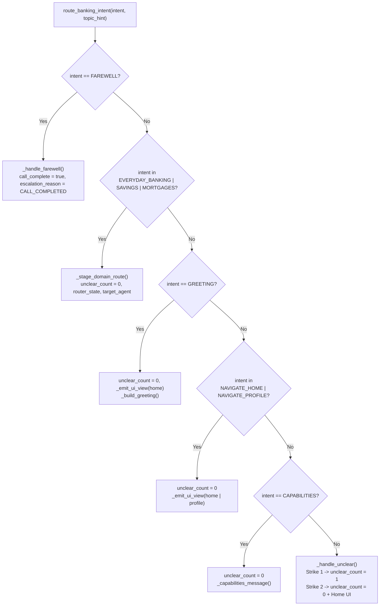

# `route_banking_intent` Specification

- **Owning Agent:** `root_agent`
- **Implementation:** [python_code.py](../../cloudbank/cxas_app/Cloudbank/tools/route_banking_intent/python_function/python_code.py#L1-L167) (entrypoint at [`#L13-L85`](../../cloudbank/cxas_app/Cloudbank/tools/route_banking_intent/python_function/python_code.py#L13-L85))
- **Manifest:** [route_banking_intent.json](../../cloudbank/cxas_app/Cloudbank/tools/route_banking_intent/route_banking_intent.json)

## 1. Overview & Architectural Principles

`route_banking_intent` is the entry concierge controller on `root_agent`. It handles greetings, top-level screen navigation (`Home`, `Profile`), capability inquiries, session farewells, and silent routing into the three specialist product agents (`everyday_banking_agent`, `savings_agent`, `mortgage_agent`).

Core invariants:
- **Single-key return:** Always returns `{"agent_action": "..."}` and catches unexpected exceptions gracefully without crashing the session.
- **Silent callback handoff:** Stages `context.state["target_agent"]` for specialist intents without ever using the words `"transfer"`, `"transferring"`, or `"connecting"`.
- **Non-terminating 2-strike unclear policy:** Strike 1 increments `unclear_count` to `"1"` and asks a brief clarifying question; Strike 2 resets `unclear_count` to `"0"`, navigates `ui_view_state` to `Home`, states full capabilities, and keeps the session open.

## 2. Complete Workflow Flowchart



## 3. Tool Signature & Parameters

```python
def route_banking_intent(
    intent: Literal[
        "",
        "GREETING",
        "EVERYDAY_BANKING",
        "SAVINGS",
        "MORTGAGES",
        "NAVIGATE_HOME",
        "NAVIGATE_PROFILE",
        "CAPABILITIES",
        "UNCLEAR",
        "FAREWELL",
    ] = "",
    topic_hint: str = "",
) -> dict:
```

| Parameter | Type | Required | Description |
| :--- | :--- | :--- | :--- |
| `intent` | `Literal[...]` | No (default `""`) | High-level banking intent spoken by the caller (`"GREETING"`, `"EVERYDAY_BANKING"`, `"SAVINGS"`, `"MORTGAGES"`, `"NAVIGATE_HOME"`, `"NAVIGATE_PROFILE"`, `"CAPABILITIES"`, `"UNCLEAR"`, or `"FAREWELL"`). |
| `topic_hint` | `str` | No (default `""`) | Short summary of the caller's specific question or request, or `""` when none was given. |

## 4. Sub-Flow Details & Session State Reads/Writes

### Helper Index

- [`_emit_ui_view`](../../cloudbank/cxas_app/Cloudbank/tools/route_banking_intent/python_function/python_code.py#L88-L94): Increments `ui_view_state.seq` monotonically and writes the new page payload.
- [`_stage_domain_route`](../../cloudbank/cxas_app/Cloudbank/tools/route_banking_intent/python_function/python_code.py#L97-L107): Resets `unclear_count = "0"`, writes `router_state`, and sets `target_agent` (`everyday_banking_agent`, `savings_agent`, or `mortgage_agent`).
- [`_build_greeting`](../../cloudbank/cxas_app/Cloudbank/tools/route_banking_intent/python_function/python_code.py#L110-L124): Composes a time-of-day (`morning`, `afternoon`, `evening`) and `first_name`-aware greeting introducing all three banking areas.
- [`_capabilities_message`](../../cloudbank/cxas_app/Cloudbank/tools/route_banking_intent/python_function/python_code.py#L127-L135): Summarises support across everyday spending, savings goal projections, and mortgages.
- [`_handle_unclear`](../../cloudbank/cxas_app/Cloudbank/tools/route_banking_intent/python_function/python_code.py#L138-L151): Implements the non-terminating 2-strike unclear ladder.
- [`_handle_farewell`](../../cloudbank/cxas_app/Cloudbank/tools/route_banking_intent/python_function/python_code.py#L154-L167): Sets `call_complete = "true"` and `escalation_reason = "CALL_COMPLETED"` so `release_line` appends `Part.from_end_session`.

### Session State Reads & Writes

| Variable | Direction | Purpose |
| :--- | :--- | :--- |
| `first_name` | Read | Personalises greeting and farewell copy when present. |
| `time_of_day` | Read | Selects `"Good morning"`, `"Good afternoon"`, or `"Good evening"`. |
| `target_agent` | Write | Stages silent specialist handoff for `capture_utterance`. |
| `router_state` | Write | Stores `{"last_intent": intent, "topic_hint": hint}`. |
| `ui_view_state` | Read / Write | Increments `seq` when opening `home` or `profile` (and on Strike 2 reset). |
| `unclear_count` | Read / Write | Tracks `"0"` / `"1"` across hub and spokes without terminating on Strike 2. |
| `call_complete` | Write | Set to `"true"` on `FAREWELL`. |
| `escalation_reason` | Write | Set to `"CALL_COMPLETED"` on `FAREWELL`. |
